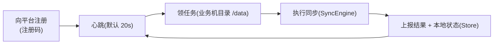

# agent —— 采集 Agent(独立节点进程)

## 业务流程框架图(采集 Agent)



**与 v2 的关系**:它是仓库里"平台 + 独立节点进程"的既有范式;v2 的**计算面服务与它同构**
(注册/心跳/领指令/执行/上报)。


`dcp-agent`:与平台主后端平级的**独立部署进程**(maven-shade 打包,非 Spring),
是仓库里"平台 + 独立节点进程"的既有范式 —— **v2 的计算面 worker 与它同构**。

## 职责

| 类 | 作用 |
|---|---|
| `AgentMain` | 进程入口:注册 → 心跳 → 领任务 → 执行 → 上报 |
| `PlatformClient` | 与平台通信(注册码、心跳、任务下发) |
| `SyncEngine` | 同步执行引擎 |
| `Store` | 本地状态(数据目录) |
| `AgentConfig` | 配置(平台地址/注册码/数据目录/心跳间隔) |

## 运行参数(环境变量)

```
DCP_AGENT_PLATFORM_URL   平台地址(默认 http://dcp-backend:8080)
DCP_AGENT_REGISTER_CODE  注册码
DCP_AGENT_DATA_DIR       本地数据目录(默认 /var/lib/dcp-agent)
DCP_AGENT_HEARTBEAT_SEC  心跳间隔(默认 20)
```

容器内业务机文件目录挂载在 `/data`(任务源)。
