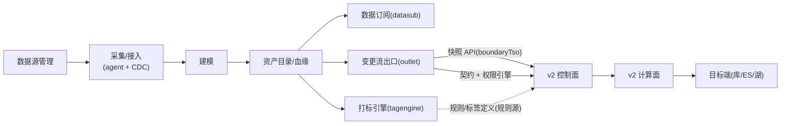

# backend —— 平台主后端(data-collect-platform)

## 业务流程框架图(平台主干,与 v2 的接点)



**与 v2 的接点只有三处**:快照 API、契约与权限引擎、规则源。**不改造主干架构。**


数据采集平台的主后端(Spring Boot + MyBatis-Plus)。**v2 消费通道复用它的出口能力**,但不并入它:
v2 有独立的控制面/计算面服务(`outlet-service` / `outlet-worker-service`)。

## 与 v2 相关的既有能力(可直接复用)

| 能力 | 类 | v2 中的用法 |
|---|---|---|
| 变更流出口(快照/增量/位点) | `com.dcp.module.outlet.ChangeOutletService` · `OutletController` | **批阶段快照源**走它的 `/snapshot?boundaryTso=` 接口 |
| 契约与权限 | `model.Contract` · **`OutletPermissionEngine`** · `tagengine.perm.DataSecurityService` | v2 契约裁剪**复用引擎**(`outlet/v2/PlatformContractViewFactory` 桥接),铁律"契约 ∩ 主体"不变 |
| 消费方账号 | `model.ConsumerAccount` | 流级校验/配额 |
| 出口监控 | `OutletStackCollector` · `metrics/*` | changefeed / Kafka 栈指标与告警规则 |
| 快照与批作业 | `SnapshotsJobService` · `batch/*`(Local/Spark 执行器) | 存量打底的既有实现 |

## 其他模块(简述)

datasub(数据订阅)· tagengine(打标引擎:规则/标签/在线打标/权限策略)· assetcat(资产目录)·
model(建模)· lineage(血缘)· datasource(数据源)· monitor 等。

## 构建与运行

```bash
# 本地无 mvn 时,仓库提供了 docker 构建方式(见 docker-compose.yml / settings-docker.xml)
docker compose up -d backend frontend
# 平台后端容器端口:8081 -> 容器内 8080
```

## 说明

本 README 由 v2 工作顺带补齐(此前缺失);内容以代码为准。
