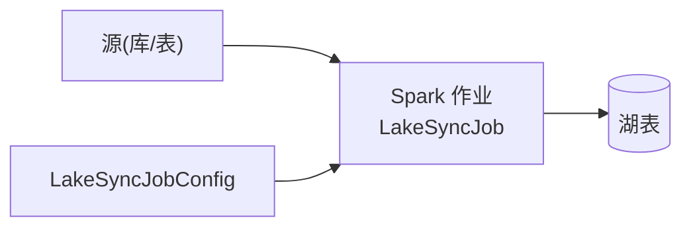

# dcp-lakesync —— 湖表同步作业(Spark)

## 业务流程框架图(湖同步作业)

**与 v2 的关系**:既有形态是"独立 Spark 作业"。v2 之后可改写为
**一个 logic(`MIRROR` 语义)+ 一份任务配置**,从而复用统一起点/租约/提交/幂等/监控;
湖特有的小文件合并、schema 演进、删除语义由 logic 自行吸收。

把源表同步到湖表的 **Spark 作业**(独立 maven 工程,与 backend 平级)。

| 类 | 作用 |
|---|---|
| `LakeSyncJob` | 作业主体:读取 → 转换 → 写入湖表 |
| `LakeSyncJobConfig` | 作业配置(源/目标/模式等) |
| `LakeSyncSmokeMain` | 冒烟入口(本地跑通语义用) |

## 与 v2 的关系

v2 的**湖同步任务**走"平台托管逻辑 + 计算单元"(`MIRROR` 语义由 logic 实现),
本工程是既有形态(独立 Spark 作业)。两者目标一致:**v2 之后,这类作业可改写为 logic + 任务配置**,
从而复用统一起点/租约/提交/监控。迁移时注意:湖特有的小文件合并、schema 演进、删除语义
由 logic 自行吸收(平台不感知)。
