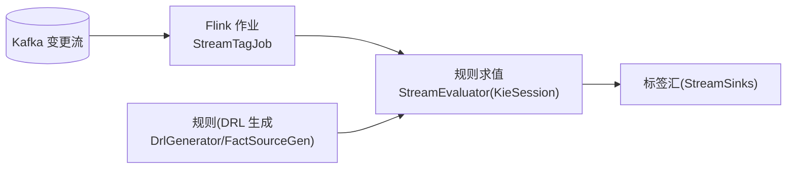

# dcp-tagstream —— 流式打标作业(Flink)

## 业务流程框架图(流式打标作业)

**与 v2 的关系**:规则/标签定义仍来自平台打标引擎(`tagengine`);消费侧可迁到 v2 ——
同一份 logic 求值,复用 v2 的**起点/租约/提交/幂等/监控**,不必各自维护位点与重投。

变更流上的**流式打标作业**(Flink),用动态 DRL 规则对事件求值并写标签。

| 类 | 作用 |
|---|---|
| `StreamTagJob` | Flink 作业主体(源 → 求值 → 汇) |
| `StreamEvaluator` | 规则求值(KieSession) |
| `kie/` | DRL 生成与 KieBase 构建(`DrlGenerator`/`FactSourceGen`/`BuildPlan`) |
| `StreamSinks` | 结果写出 |
| `StreamConfig` | 作业配置 |

## 与 v2 的关系

v2 的打标定位是:**规则与标签定义仍由平台打标引擎(`tagengine`)提供**,消费侧改成
"v2 托管逻辑(或独立服务)按同一份 logic 求值"。本工程是既有的 Flink 形态;
迁到 v2 后可复用统一的**起点/租约/提交/幂等/监控**,不必各自维护位点与重投。
