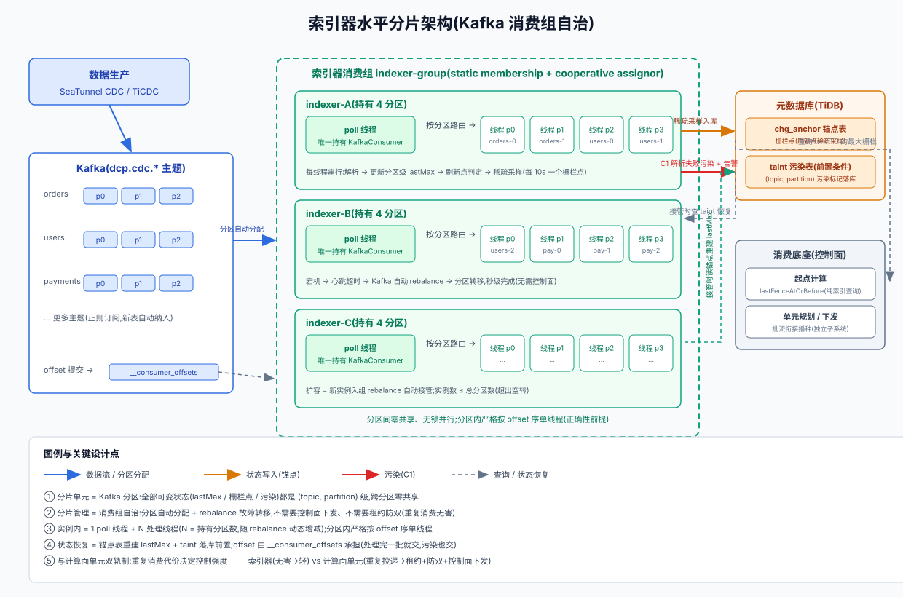

# 索引器水平分片设计(锚点/血缘索引)

> 状态:设计稿(未实施)。适用形态:PB 级流量下索引器吞吐扩展。

**定位与核心问题。** 索引器(IndexerRunner)是批流衔接栅栏方案的常驻观测者:连续消费全部 CDC 主题,维护每个 `(topic, partition)` 的历史最大 commitTs(`lastMax`),把"刷新点"稀疏采样为栅栏索引落锚点表,同时喂给血缘采样器。现行实现是**单 KafkaConsumer(正则订阅全部 topic)+ 单线程逐条同步处理**——这是正确性选择而非性能选择(栅栏判定要求按 offset 序逐条比较,乱序检测、C1 污染都以顺序读为前提),但 PB 级日增量(百亿级消息)下单线程吞吐差 2~3 个数量级,索引器成为主链路第一个断掉的环节。本方案把索引器从单实例单线程扩展为**消费组多实例、每分区一线程**,核心结论:**分片单元 = Kafka 分区,分片管理 = 消费组自治,不需要控制面下发、不需要租约防双**——因为索引器"重复消费无害、状态可重建",与计算面单元(重复消费 = 业务重复投递)分属两种控制强度。

## 一、为什么可以分片:状态全是分区级

索引器的全部可变状态——`lastMax`、栅栏点、污染标记、采样进度——**粒度全部是 `(topic, partition)`**,跨分区之间零共享。因此:

1. 分片不需要发明任何分片协议:Kafka 的 partition 就是现成的分片单元,消费组机制就是现成的分片管理;
2. 实例内可以按分区并行(每分区一线程),分区间无锁;
3. 分区内必须严格按 offset 序单线程处理——这是不可动摇的正确性前提,分片只改变"谁处理",不改变"怎么处理"。

**重复消费无害是消费组自治的立足点**:同一消息被重读,`commitTs ≥ lastMax` 的刷新判定重算一遍(相等不刷新)、非刷新点永不入库、重复入库被 `(topic, partition)` 唯一约束去重。重复消费只让状态重算,不产生错误。

## 二、分片模型:消费组 + 每分区一线程

```
Kafka(全部 CDC 主题,分区数 P)                实例内
┌────────────────────────────┐    ┌────────────────────────────────┐
│ topic A: p0 p1 p2          │    │ indexer-N 进程                  │
│ topic B: p0 p1 p2          │    │  1 个 poll 线程(唯一持有        │
│ topic C: p0 p1 p2          │    │    KafkaConsumer 的线程)        │
└──────────┬─────────────────┘    │    → 按分区路由到各分区队列      │
           │ 组:indexer-group      │   N 个处理线程(N = 持有分区数)  │
    分区自动分配(rebalance)         │   每线程只吃一个分区的队列:     │
┌──────────┴─────────┬───────────┐ │     串行解析 → 更新 lastMax     │
│ indexer-A  indexer-B  indexer-C │ │     → 刷新点判定 → 稀疏采样入库 │
└────────────────────────────────┘ └────────────────────────────────┘
```

1. N 个实例组成**同一个消费组**(`group.id` 固定),正则订阅全部 topic,Kafka 自动分配分区;
2. **实例数 ≤ 总分区数**,超出部分空转(与单元规划"instances > 分区数拒绝"同哲学);
3. 实例内:**1 个 poll 线程 + N 个处理线程**,N = 该实例当前实际持有的分区数,**随 rebalance 动态增减**;
4. poll 线程只拉消息、按分区路由;处理线程串行吃自己分区的队列——分区内顺序天然保持,分区间零共享、无锁并行;
5. 简化版:小规模环境可只开 1 个线程全包(跨分区串行无害,并行度 = 实例数)。

## 三、状态恢复:lastMax 重建 + taint 落库

rebalance/重启后,新实例接管分区,内存没有 `lastMax`,恢复分两步:

1. **查污染表**:`(topic, partition)` 有 taint 记录 → `lastMax = +∞` → 该分区不再产栅栏,查询退化 earliest(与 C1 行为一致);
2. **读锚点表**:取该分区最近一条栅栏记录,以它的 commitTs 重建 `lastMax`;栅栏点之后的少量消息被重复消费——幂等无害,恢复代价只是短扫窗口变长,正确性零损失。

**taint 落库是分片的前置条件**:现行 taint 是内存态,单实例重启尚且有"静默信任锚点表"的隐患,分片后隐患变成必然——分区转移后新实例不知道该分区被污染过,会从"看似正常"的锚点重建,继续产出假栅栏,直接违反 C1 的终极目的(防漏数)。落地顺序上 taint 落库必须先于分片。

**消费进度(offset)** 由 Kafka `__consumer_offsets` 承担:显式提交(`ENABLE_AUTO_COMMIT=false`),处理完一批就交,**污染也交**(位点不卡死);提交失败只告警,下轮重试——重启重放对索引器幂等(锚点 upsert / 水位 upsert / 污染 INSERT IGNORE)。

## 四、故障转移与扩缩容

- **实例宕机**:心跳超时(超过 session.timeout)→ Kafka 协调器触发 rebalance → 分区自动转移给存活成员,秒级完成,**不需要控制面介入**;
- **扩容**:新实例入组 → rebalance 自动接管部分分区,零配置;
- **缩容**:实例优雅退出 → 分区转移;
- **防抖动**:实例用固定 `instanceId`(static membership)+ cooperative-sticky assignor——滚动重启只动必要分区,不触发全组大搬家;会话超时调大容忍 GC 停顿。

## 五、与计算面单元的分工(双轨制判据)

| 判据 | 索引器(本方案) | 计算面单元 |
|---|---|---|
| 重复消费代价 | 无害(状态重算/幂等 upsert) | 有害(业务重复投递) |
| 精确起点 | 不需要(offset.reset + 提交位点) | 需要(批流衔接起点,控制面 seek 注入) |
| 分片管理 | Kafka 消费组自治 | 控制面下发 + 租约 + 防双唯一键 |
| 挂掉转移 | 自动 rebalance,秒级 | 等租约过期 → 重下发,分钟级 |
| 状态恢复 | 锚点表重建 lastMax | DB 位点起步,位点不猜 |

判据一句话:**"重复消费的代价"决定分布式控制的强度。** 索引器重复消费只损失窗口大小、不损失正确性,所以敢用消费组的粗放机制;计算面单元重复消费即重复投递,才需要租约/防双/控制面下发那一整套。

## 六、架构图



## 七、容量估算(PB 级)

- 消息量:日均 10^10 条 ≈ 11.5 万条/秒;
- 单线程吞吐上限 ~5 万条/秒(JSON 解析 + commitTs 提取 + DML 判断)→ 起步 3~4 实例,留余量部署 8~16 实例;
- 每实例 20~30 分区,实例内线程数 = 分区数,并行度充足;
- 锚点表写入:500 分区 × 每 10s 一个栅栏点 ≈ 50 行/秒(稀疏采样已消化写放大),元数据库无压力;
- 结论:分片后索引器退出瓶颈行列,瓶颈转移到 Kafka 分区规划与血缘下游(Neo4j)。

## 八、落地顺序与前置条件

1. **taint 落库**(前置):污染标记持久化 + 接管时查询恢复;
2. **单实例接入消费组**:验证 rebalance 后状态恢复(锚点表重建 lastMax);
3. **多实例横向扩容 + 压测**:静态成员 + cooperative assignor;
4. **分区内流水线**(后置,仅当单分区热点实测出现):解析并行、判定顺序。

**不变式**:C1(解析失败污染 +∞ 并告警)/ C2(ts 口径一致,上线前回放对账)/ C3(起点接线唯一化)/ P(retention 边界规范化)四条契约全部保留;栅栏采样规则(仅刷新点入库、可稀疏)不变;MonotonicityGuard 按栅栏化改造降级为观测指标。
