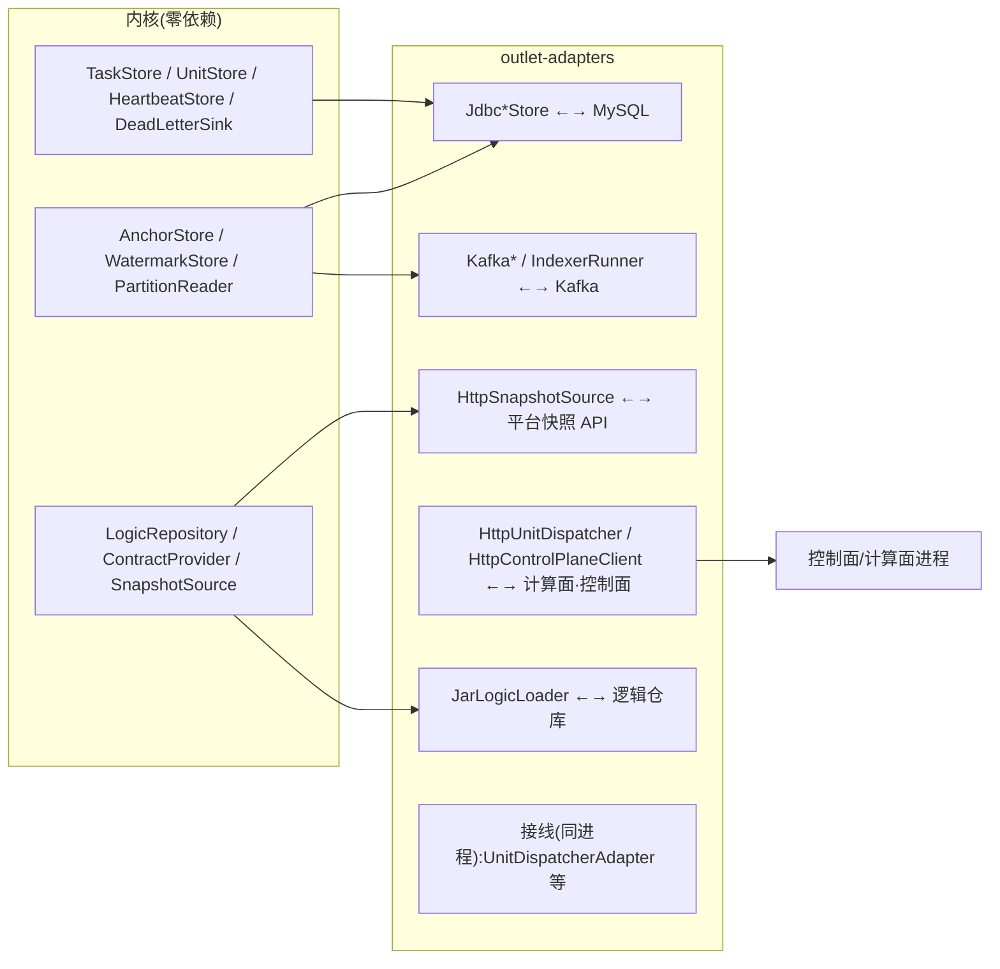

# dcp-outlet-adapters —— 生产适配层

## 业务流程框架图(内核 ↔ 真实世界)



**边界**:只有本模块知道"MySQL/Kafka/HTTP 长什么样";内核只认接口,因此**可离线自检**。


把零依赖的内核接到**真实中间件**:元数据库(MySQL)、Kafka、平台快照 API、逻辑仓库。

| 域 | 类 |
|---|---|
| 元数据落库 | `JdbcAnchorStore` · `JdbcWatermarkStore` · `JdbcStreamRegistry` · `JdbcTaskStore` · `JdbcUnitStore` · `JdbcHeartbeatStore` · `JdbcUnitStatusStore` · `JdbcDeadLetterSink` |
| Kafka | `KafkaPartitionReader`(轻量读 commitTs)· `KafkaAdminStreamScanner`(**新表感知**)· `KafkaRecordSource`(计算面真消费源:assign+seek+commitSync,不用 subscribe)· `IndexerRunner`(**锚点索引器常驻**,groupId 可配) |
| 两平面协议 | `UnitCommandCodec`(指令)· `ContractViewCodec`(契约视图)· `HttpUnitDispatcher` · `HttpControlPlaneClient`(心跳/续约)· `HttpContractProvider`(**fail-closed**) |
| 批阶段 | `HttpSnapshotSource`(**走平台快照 API**,不自己拼 `AS OF TIMESTAMP`)· `SnapshotRecord` · `SchedulerBatchRunner`(接调度器) |
| 逻辑仓库 | `LogicRepository`/`LogicArtifact` · `FileLogicRepository`(目录 + sha256 sidecar)· `JarLogicLoader`(校验 + 独立 ClassLoader) |
| 辅助 | `CanalJson`(轻量解析)· `Json`/`FlatJson`(极简 JSON,刻意不引库)· `PlatformMasker`(与引擎 `applyMask` 同源)· `DriverManagerDataSource` |

## 接线(由 outlet-integration 并入)

| 类 | 作用 |
|---|---|
| `UnitDispatcherAdapter` | 控制面 `DispatchRequest` → 计算面 `CreateUnitCmd` → `UnitRunner.start`(同进程部署) |
| `LeaseBackedLeaseGuard` | 计算面续约 → 控制面 `LeaseManager`;**续约失败即单元自停** |
| `LeaseBackedHeartbeat` | 心跳落地(offset/tso/时间) |
| `SdkEventDecoder` | 极简事件解码(生产替换为完整 canal-json 解析) |

> 2026-09-16:`outlet-integration` 模块并入本模块 —— 它本就同时依赖 control 与 worker,单独成模块属冗余(详见《架构图与模块说明》§1.3)。

## 真栈自检(需要 Kafka 19092 + MySQL 3306,库 `dcp`)

```bash
KJ=~/.m2/repository/org/apache/kafka/kafka-clients/3.6.2/kafka-clients-3.6.2.jar
SJ=~/.m2/repository/org/slf4j/slf4j-api/1.7.36/slf4j-api-1.7.36.jar
MJ=~/.m2/repository/mysql/mysql-connector-java/8.0.23/mysql-connector-java-8.0.23.jar
javac --release 17 -cp /tmp/out:$KJ -d /tmp/adt $(find outlet-adapters/src -name '*.java')
for c in RealStackCheck FoundationCheck ProgressDlqCheck SnapshotSourceCheck \
         UnitCommandCodecCheck HttpDispatchCheck ContractViewHttpCheck JarLogicLoaderCheck \
         e2e.EndToEndCheck; do
  java -cp /tmp/out:/tmp/adt:$KJ:$SJ:$MJ com.dcp.outlet.adapters.$c | grep 通过
done
```
（`UnitCommandCodecCheck` / `HttpDispatchCheck` / `ContractViewHttpCheck` / `JarLogicLoaderCheck` 为协议与加载校验,不需要真中间件。）
