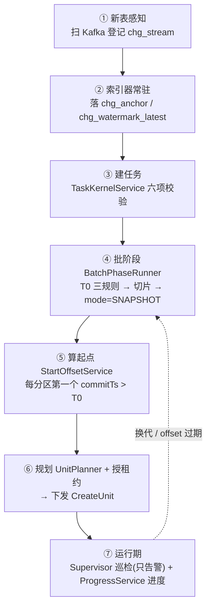

# dcp-outlet-control —— 控制面内核

## 业务流程框架图(决策链)



**边界**:本模块**不碰数据**(不读业务行、不写目标表),只做"该干什么"的判断与编排。


增量消费通道 v2 的**控制面纯逻辑**(零第三方依赖,Java 17)。
只做"决策",不做"IO":IO 一律通过端口注入,因此**可以完全离线自检**。

## 职责

| 域 | 类 | 说明 |
|---|---|---|
| 索引 | `AnchorStore` · `WatermarkStore` · `PartitionReader`(端口) | 锚点/水位/轻量读取 |
| | `AnchorIndexer` · `AnchorIndexPolicy` · `MonotonicityGuard` | 采样落锚点、水位推进、分区内 commitTs 单调性守护 |
| **起点** | **`StartOffsetService`** | 二分锚点 → 短扫 → 退化(时间索引/回扫)→ 超限 `START_TOO_OLD` |
| 规划 | `UnitPlanner` · `PlannedUnit` | `instances == Σ分区` 一单元一分区;`<` 轮询均分;`>` 拒绝;**单元不跨流** |
| 租约 | `LeaseManager` · `LeaseGrant` | 同 `(topic,partition,epoch)` 唯一持有 → 与 DB 唯一键构成双保险 |
| 任务 | `TaskRecord` · `TaskStatus` · `TaskKernelService` | **六项校验** → 落库 → 规划 → 交调度 |
| 调度 | `TaskScheduler` | `snapshot` → 批阶段(**成功才交接**);`latest` → 直接交接;交接 = 算起点 → 授租约 → 下发 |
| **批阶段** | `SlotPlanner` · `T0Selector` · `SnapshotSource` · `BatchPhaseRunner` | 切片(D18)· **T0 三规则** · 同一 logic 走 `mode=SNAPSHOT` · 全片成功才 ok |
| 巡检 | `Supervisor` · `Alert` | 租约过期/单元缺失/停滞/期望运行无 RUNNING/批失败——**只告警不补齐** |
| 进度 | `ProgressService` · `PartitionProgress` | `lagSeconds = (水位TSO−已处理TSO)>>18` · `lagRows = 末端−已提交` |

## 依赖

`dcp-outlet-sdk`(批阶段要用同一份 `ConsumerLogic`)。**不依赖 Spring / 数据库 / Kafka。**

## 自检

```bash
javac --release 17 -d /tmp/out -cp outlet-sdk/src/main/java $(find outlet-sdk/src/main outlet-control/src -name '*.java')
java -cp /tmp/out com.dcp.outlet.control.SelfCheck                 # 起点 22
java -cp /tmp/out com.dcp.outlet.control.OrchestrationSelfCheck    # 编排 53
java -cp /tmp/out com.dcp.outlet.control.ProgressSelfCheck         # 进度 7
java -cp /tmp/out com.dcp.outlet.control.SupervisorSelfCheck       # 巡检 9
java -cp /tmp/out com.dcp.outlet.control.BatchPhaseSelfCheck       # 批阶段 38
```

设计依据:《数据采集平台V3-增量消费通道详细设计-v2》§3/§4/§7。
