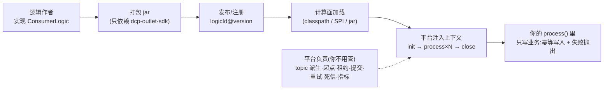

# dcp-outlet-sdk —— 增量消费通道 v2 消费逻辑编程接口

## 业务流程框架图(你在整条链路里的位置)



**一句话**:本模块是**业务与平台之间唯一的契约面** —— 你实现一个接口,平台负责把它跑起来。


零第三方依赖。**业务逻辑工程只依赖本模块**,不依赖平台后端。

## 一分钟上手

```java
@ConsumerLogicDef(logicId = "es-sync", version = "1.0.0")
public class EsSyncLogic implements ConsumerLogic {

    private RestHighLevelClient es;                       // 单元级状态

    @Override public void init(LogicInitContext ctx) {    // ① 每单元一次
        this.es = new RestHighLevelClient(RestClient.builder(
                HttpHost.create((String) ctx.params().get("esUrl"))));
    }

    @Override public void process(Batch batch, ConsumerContext ctx) {   // ② 每批一次(单线程)
        BulkRequest bulk = new BulkRequest();
        for (Record r : batch.records()) {
            // 幂等:_id = 业务主键
            ...
        }
        BulkResponse resp = es.bulk(bulk, RequestOptions.DEFAULT);     // 同步等结果
        if (resp.hasFailures()) throw new SdkException(resp.buildFailureMessage());  // 失败要抛
    }

    @Override public void close() { es.close(); }         // ③ 停机一次
}
```

## 三条契约(违反后果自负)

| # | 契约 | 违反后果 |
|---|---|---|
| 1 | **幂等**:同一批重复投递不得产生脏数据 | 至少一次投递下必然重复 → 脏数据 |
| 2 | **失败要抛**:`process()` 出错就抛异常 | 吞异常 = 静默丢数 |
| 3 | **不开线程池**:需要并发请加 `instances` / 加分区 | 破坏单线程串行保证 |

## 平台替你做的事

topic 派生 · 起点计算 · 分区分配 · `KafkaConsumer` 创建/assign/seek · **offset 提交** ·
重试 · 死信 · 心跳 · 租约 · 契约裁剪(列/行/密级/脱敏) · 批阶段打底 · 批流交接 · 指标告警

## 逻辑加载方式(四选一)

| 方式 | 注册 | 升级代价 |
|---|---|---|
| ① 写在 worker 里 | 注解 + Bean 自动扫描 | 重启 worker |
| ② 扩展包 SPI | `META-INF/services/com.dcp.outlet.sdk.ConsumerLogicProvider` | 换 jar + 重启 |
| ③ 逻辑仓库 jar | 发布流程注册(pom 引本 SDK 构建 jar) | 按任务滚动升级 |
| ④ 内置算子 | 不写代码 | 平台升级 |

## 模块内容

| 类型 | 文件 |
|---|---|
| 逻辑接口 | `ConsumerLogic`(init/process/close)· `LogicInitContext` |
| 数据模型 | `Batch` · `Record` · `Op` · `Mode` |
| 运行上下文 | `ConsumerContext` |
| 注册与加载 | `ConsumerLogicDef` · `LogicRef` · `LogicRegistry` · `InMemoryLogicRegistry` · `ConsumerLogicProvider` · `LogicLoader` · `LoadedLogic` |
| 辅助 | `SdkLogger` · `SdkException` · `LogicNotFoundException` |

参考实现:`src/test/java/com/dcp/outlet/sdk/example/EsSyncExampleLogic.java`(编译验证用)
