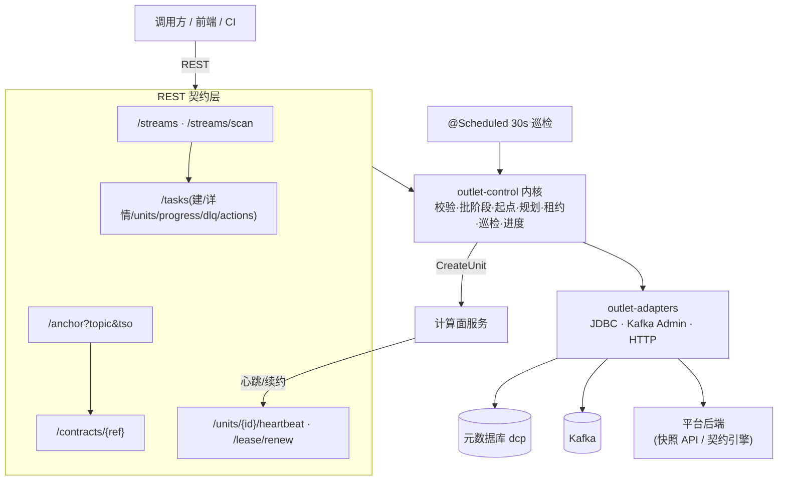

# dcp-outlet-control-service —— 控制面独立服务

## 业务流程框架图(控制面服务)



**边界**:服务层**只做装配与暴露**;所有决策都在内核,便于离线验证。


数据消费平台 v2 的**控制面服务**(Spring Boot 3.3,**独立部署**,不并入 `dcp-backend`)。
它把 `outlet-control`(内核)、`outlet-adapters`(生产适配)装配起来,对外只暴露 REST 契约。

## 职责

| 域 | 说明 |
|---|---|
| 流登记 | 新表感知扫描结果的可视化与手动触发 |
| 任务 | 建任务(通用入口)· 详情 · 单元列表 · 进度(每分区 offset → TSO → 滞后) |
| 起点 | `TSO → 每分区起始 offset`(带 `via`,排障时能看出走的是快路径还是退化路径) |
| 契约 | 契约视图下发(计算面拉取;**fail-closed**) |
| 上报 | 计算面心跳落库 · 租约续约 |
| 巡检 | `@Scheduled` 每 30s:租约过期回收 + 逐任务对账,**只告警不补齐** |

## REST 契约

```
GET    /api/outlet/streams                      可消费流列表
POST   /api/outlet/streams/scan                 手动触发新表感知
GET    /api/outlet/tasks                        任务列表
POST   /api/outlet/tasks                        建任务
GET    /api/outlet/tasks/{id}                   任务详情
GET    /api/outlet/tasks/{id}/units             消费单元列表
GET    /api/outlet/tasks/{id}/progress          进度(含每分区滞后)
GET    /api/outlet/tasks/{id}/dlq               死信列表
POST   /api/outlet/dlq/{dlqId}/replay           标记死信已重放
POST   /api/outlet/tasks/{id}/actions/{pause|resume|stop}
GET    /api/outlet/anchor?topic=&tso=           起点查询
GET    /api/outlet/contracts/{ref}?consumerId=&stream=   契约视图
POST   /api/units/{unitId}/heartbeat            计算面上报
POST   /api/units/{unitId}/lease/renew          计算面续约
```

## 配置(关键项)

```yaml
outlet:
  meta:   { jdbc-url: jdbc:mysql://127.0.0.1:3306/dcp, username: root, password: <环境变量注入> }
  kafka:  { bootstrap: 127.0.0.1:19092, topic-prefix: "dcp.cdc." }
  start-offset: { max-scan-rows: 200000 }
  worker: { url: http://127.0.0.1:8096 }        # CreateUnit 下发目标
  # 批阶段(snapshot)T0 三适配器:
  ticdc:   { base-url: http://127.0.0.1:18300, changefeed-id: chg-target-db-v4 }   # R1 changefeed 起点
  tidb:    { jdbc-url: jdbc:mysql://127.0.0.1:14000/mysql, username: root, password: root123 }  # R2 GC safe point
  snapshot: { base-url: http://127.0.0.1:8081, consumer-id: "" }                    # 快照源(平台 API)
  logic:   { repo: ./logic-repo }                                                  # 批/增量同一份 logic
  epoch: 1                                                                          # 水位/锚点 epoch(与索引器一致)
```

DB 密码**只从环境变量注入**(`OUTLET_META_PASSWORD`),不落盘;其余项同样可用 `OUTLET_*` 覆盖。

## 状态

**已本地真起(8095)**且 bean 图完整(启动实测);数据类接口需注入元数据库密码后才能验。

**批阶段(`startPolicy=snapshot`)已接线**(T0 三适配器 → `SchedulerBatchRunner`):

| 适配器 | 来源 | 对应规则 |
|---|---|---|
| `TiCdcChangefeedStartTs` | TiCDC OpenAPI v2 `start_ts`(缓存) | R1 `T0 ≥ changefeed.start_ts` |
| `TiDbGcSafePoint` | TiDB `mysql.tidb.tikv_gc_safe_point`(时间 → TSO) | R2 `T0 ≥ GC safe point` |
| `WatermarkStoreLatestTs` | `chg_watermark_latest` 水位表 | R3 `T0 ≤ latest` |

**未接线项(已知,已用明确拒绝代替静默放行)**:

| 项 | 现状 |
|---|---|
| 主体侧行规则(「契约 ∩ 主体」的行级交集) | 列级已有 `SubjectColumnPolicy` 端口(现为 permissive);行级尚无端口 —— **契约行条件当前生效,主体行规则未叠加** |
| 批/增量身份一致性 | 快照源 `consumer-id` 现为**服务级配置**(非按任务),须与任务契约的 consumer 对齐;多 consumer 混布时需把 consumerId 按任务透传 |
| 容器化 | Dockerfile + compose 片段待补 |

启动方式(仓库根目录;`<cp>` 由 `mvn dependency:build-classpath` 产出):

```bash
OUTLET_META_PASSWORD=*** java -cp "<cp>:outlet-service/target/classes" \
  com.dcp.outlet.service.OutletServiceApplication --server.port=8095
```
建表脚本:`outlet/v2-meta-ddl.sql`。
