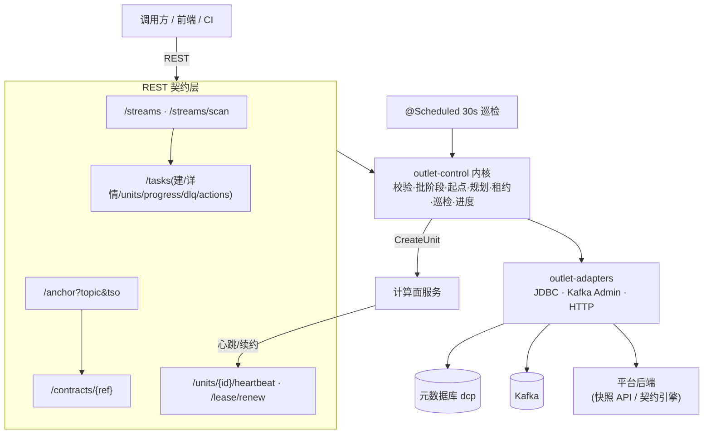

# dcp-outlet-control-service —— 控制面独立服务

## 业务流程框架图(控制面服务)



**边界**:服务层**只做装配与暴露**;所有决策都在内核,便于离线验证。


数据消费平台 v2 的**控制面服务**(Spring Boot 3.3,**独立部署**,不并入 `dcp-backend`)。
它把 `outlet-control`(内核)、`outlet-adapters`(生产适配)装配起来,对外只暴露 REST 契约。

## 职责

| 域 | 说明 |
|---|---|
| 流登记 | 新表感知扫描结果的可视化与手动触发 |
| 任务 | 建任务(通用入口)· 详情 · 单元列表 · 进度(每分区 offset → TSO → 滞后) |
| 起点 | `TSO → 每分区起始 offset`(带 `via`,排障时能看出走的是快路径还是退化路径) |
| 契约 | 契约视图下发(计算面拉取;**fail-closed**) |
| 上报 | 计算面心跳落库 · 租约续约 |
| 巡检 | `@Scheduled` 每 30s:租约过期回收 + 逐任务对账,**只告警不补齐** |

## REST 契约

```
GET    /api/outlet/streams                      可消费流列表
POST   /api/outlet/streams/scan                 手动触发新表感知
GET    /api/outlet/tasks                        任务列表
POST   /api/outlet/tasks                        建任务
GET    /api/outlet/tasks/{id}                   任务详情
GET    /api/outlet/tasks/{id}/units             消费单元列表
GET    /api/outlet/tasks/{id}/progress          进度(含每分区滞后)
GET    /api/outlet/tasks/{id}/dlq               死信列表
POST   /api/outlet/dlq/{dlqId}/replay           标记死信已重放
POST   /api/outlet/tasks/{id}/actions/{pause|resume|stop}
GET    /api/outlet/anchor?topic=&tso=           起点查询
GET    /api/outlet/contracts/{ref}?consumerId=&stream=   契约视图
POST   /api/units/{unitId}/heartbeat            计算面上报
POST   /api/units/{unitId}/lease/renew          计算面续约
```

## 配置(关键项)

```yaml
outlet:
  meta:   { jdbc-url: jdbc:mysql://127.0.0.1:3306/dcp, username: root, password: *** }
  kafka:  { bootstrap: 127.0.0.1:19092, topic-prefix: "dcp.cdc." }
  start-offset: { max-scan-rows: 200000 }
```

## 状态

骨架与 REST 已就位并通过编译;**尚未本地真起过服务**(端到端 HTTP 属加分项)。
建表脚本:`outlet/v2-meta-ddl.sql`。
