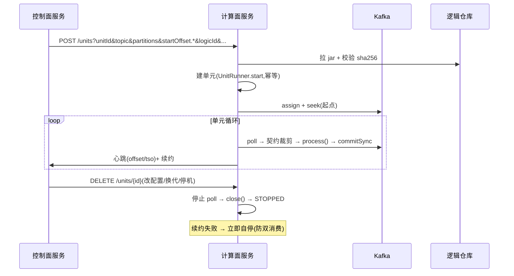

# dcp-outlet-worker-service —— 计算面独立服务

## 业务流程框架图(计算面服务)



**边界**:计算面**不做任何调度决策**;它只执行控制面下发的单元级指令,并把状态报回去。


承载消费单元的进程(Spring Boot 3.3)。**1..N 个单元 / 实例,可跨任务混布**;
与控制面通过 HTTP 交互(收指令、报心跳、续租约)。

## HTTP 接口(控制面/运维调用)

```
POST   /units                 创建单元(参数为该请求的扁平键值,见下)
DELETE /units/{unitId}        优雅停机
GET    /units/{unitId}        单元状态(状态/最近提交位点/最近 TSO)
GET    /units/health
```

创建单元的线上格式(`UnitCommandCodec`,可直接 curl):

```
unitId=.. & taskId=.. & topic=.. & stream=.. & consumerGroup=..
& logicId=.. & logicVersion=.. & partition.0=0 & partition.1=2
& startOffset.0=31785 & param.index=crm_rt_sync_c
& failure.maxRetries=5 & failure.backoffMs=2000 & failure.onFailure=stop & leaseTtlSeconds=30
```

## 装配(`WorkerConfig`)

| 项 | 实现 |
|---|---|
| 逻辑加载 | `CompositeLogicLoader(SpiLogicLoader, ClasspathLogicLoader)`(③ jar 加载见 `outlet-adapters.JarLogicLoader`) |
| 消费源 | `KafkaRecordSource.Factory`(assign + seek + commitSync,**不用 subscribe**) |
| 契约 | `DefaultContractFilter` + 视图(生产用 `HttpContractProvider` 从控制面拉取) |
| 心跳/续约 | `HttpControlPlaneClient` → 控制面;续约失败 → 单元自停 |
| 日志 | `Slf4jSdkLogger`(SDK 日志门面 → worker 自身 slf4j,带 unitId 前缀) |

## 配置(关键项)

```yaml
outlet:
  control: { url: http://127.0.0.1:8081 }
  kafka:   { bootstrap: 127.0.0.1:19092 }
```

## 状态

骨架已就位并通过编译;**尚未本地真起过服务**。
