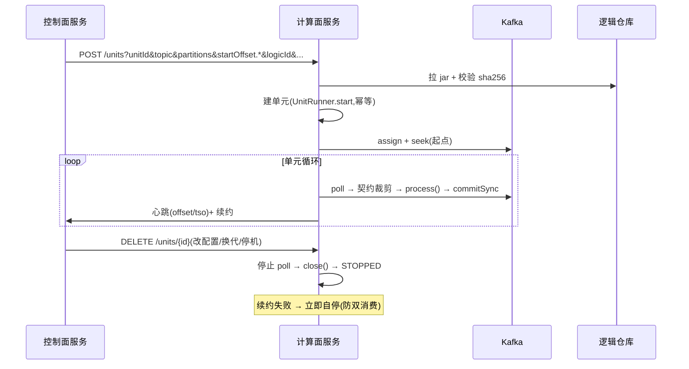

# dcp-outlet-worker-service —— 计算面独立服务

## 业务流程框架图(计算面服务)



**边界**:计算面**不做任何调度决策**;它只执行控制面下发的单元级指令,并把状态报回去。


承载消费单元的进程(Spring Boot 3.3)。**1..N 个单元 / 实例,可跨任务混布**;
与控制面通过 HTTP 交互(收指令、报心跳、续租约)。

## HTTP 接口(控制面/运维调用)

```
POST   /units                 创建单元(参数为该请求的扁平键值,见下)
DELETE /units/{unitId}        优雅停机
GET    /units/{unitId}        单元状态(状态/最近提交位点/最近 TSO)
GET    /units/health
```

创建单元的线上格式(`UnitCommandCodec`,可直接 curl):

```
unitId=.. & taskId=.. & topic=.. & stream=.. & consumerGroup=..
& logicId=.. & logicVersion=.. & partition.0=0 & partition.1=2
& startOffset.0=31785 & param.index=crm_rt_sync_c
& failure.maxRetries=5 & failure.backoffMs=2000 & failure.onFailure=stop & leaseTtlSeconds=30
```

## 装配(`WorkerConfig`)

| 项 | 实现 |
|---|---|
| 逻辑加载 | `CompositeLogicLoader(JarLogicLoader, SpiLogicLoader, ClasspathLogicLoader)` —— 三种方式都通,jar 优先 |
| 消费源 | `KafkaRecordSource.Factory`(assign + seek + commitSync,**不用 subscribe**) |
| 契约 | `HttpContractProviderFactory`(按单元 `contractRef` 从控制面拉视图,30s 刷新)→ `DefaultContractFilter`(列白名单 → 行条件(`ExpressionRowConditionEvaluator`,用原始行判)→ `PlatformMasker` 脱敏) |
| **契约失败语义** | 缺 `contractRef` / 拉不到且无缓存 → **单元 FAILED,连消费源都不建**(fail-closed,绝不退回全放行);刷新失败沿用上次视图 |
| 心跳/续约 | `HttpControlPlaneClient` → 控制面;续约失败 → 单元自停 |
| 日志 | `Slf4jSdkLogger`(SDK 日志门面 → worker 自身 slf4j,带 unitId 前缀) |
| 死信 | `InMemoryDeadLetterSink`(**进程内,重启即失**;要落库需加 spring-jdbc 并换 `JdbcDeadLetterSink`) |

## 配置(关键项)

```yaml
outlet:
  control:  { url: http://127.0.0.1:8095 }
  kafka:    { bootstrap: 127.0.0.1:19092 }
  logic:    { repo: ./logic-repo }              # <repo>/<logicId>/<version>.jar(+ .sha256)
  contract: { refresh-ms: 30000, timeout-ms: 3000 }
```

均可用环境变量覆盖(`OUTLET_CONTROL_URL` / `OUTLET_KAFKA_BOOTSTRAP` / `OUTLET_LOGIC_REPO` / `OUTLET_CONTRACT_REFRESH_MS`)。

## 状态

**已本地真起(8096)**且契约链路实测:

- `/units/health` = `{"ok":true}`;`POST /units` 能建单元、`GET /units/{id}` 能看状态
- 逻辑仓库 jar 生效:`loaded logic from repo: demo-logic@1.0.0 ← <repo>/demo-logic/1.0.0.jar`
- fail-closed 三种场景实测均为 **FAILED 且零提交、零行到达业务逻辑**:
  ① 单元未带 `contractRef` ② 控制面不可达 ③ 控制面起着但元数据库不可达

启动方式(仓库根目录;`<cp>` 由 `mvn dependency:build-classpath` 产出):

```bash
java -cp "<cp>:outlet-worker-service/target/classes" \
  com.dcp.outlet.workersvc.WorkerApplication --outlet.logic.repo=/path/to/logic-repo
```
