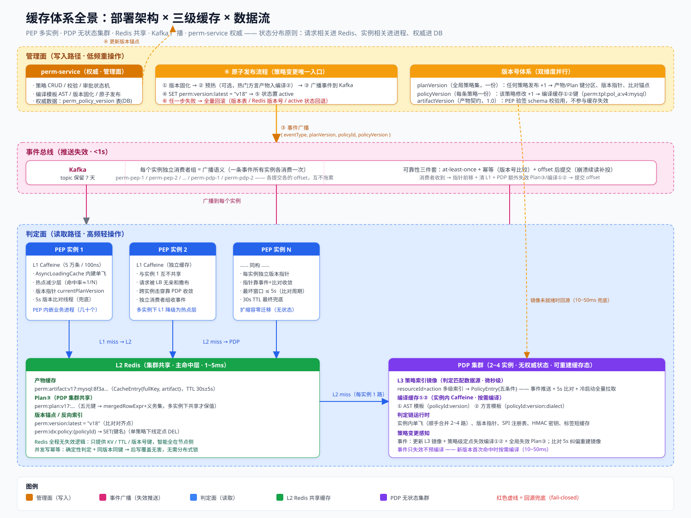
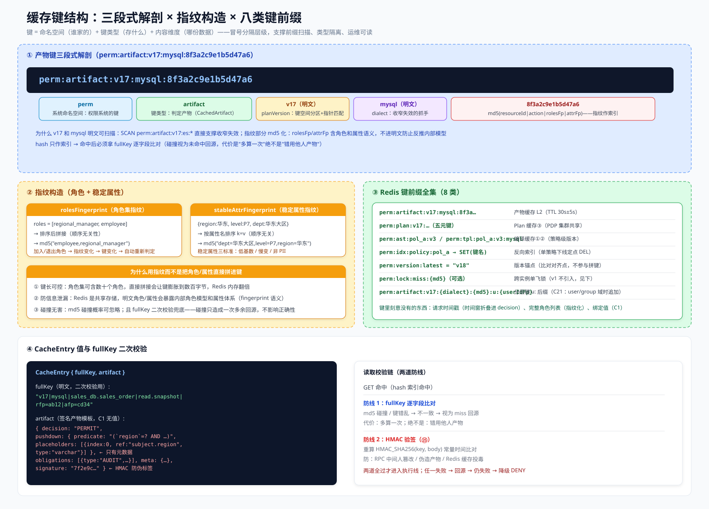
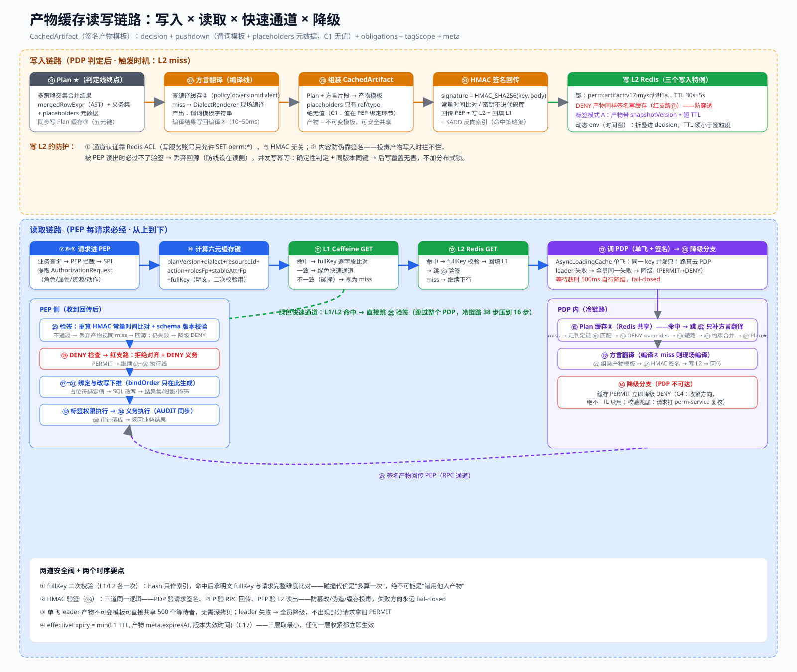
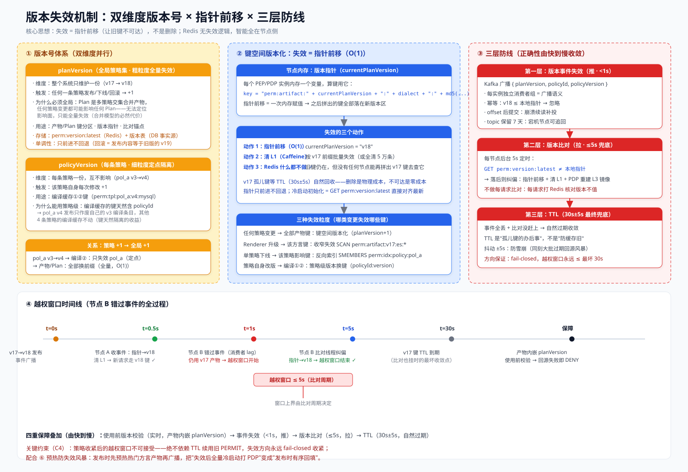

# 缓存体系设计 v1.0

> 本文是《权限系统设计文档 v1.1》§5（缓存机制）的展开详解，汇总缓存体系设计的全部细节与设计要点。
> 配套图：缓存体系全景.svg、产物缓存读写链路.svg、版本失效机制.svg、缓存键结构.svg
>
> **文档状态**：v1.0（2026-09）｜**关联**：设计文档-v1.1.md、规则定义-v1.0.md

---

## 0. 一句话总览

缓存体系 = **L1 Caffeine（进程内热点层）+ L2 Redis（集群共享主命中层）+ L3 perm-service（权威）** 三级缓存，外加 PDP 侧**编译①② + Plan③** 三兄弟。键按「命名空间 + 类型 + 内容维度」三段式构造；产物是不可变模板（C1 无值）且带 HMAC 签名；失效由**事件推（<1s）+ 版本比对拉（5s）+ TTL（30s±5s）**三层防线保证；多实例部署下以「键空间版本化（指针前移）」实现 O(1) 全量失效。

**状态分布原则**：请求相关进 Redis、实例相关进进程、权威进 DB。PEP/PDP 全部无状态可水平扩缩容。

---

## 1. 缓存体系总览

### 1.1 三级缓存（PEP 视角）

| 层级 | 实现 | 容量 | 延迟 | 说明 |
|---|---|---|---|---|
| L1 | Caffeine（进程内） | 5 万条 | ~100ns | 每 PEP 实例一份；多实例下命中率≈1/N，定位为**热点减少层** |
| L2 | Redis（分布式） | 100 万条 | 1~5ms | 集群共享，**主命中层**，命中率不受实例数影响 |
| L3 | perm-service（权威） | 全量 | 10~50ms | 权威策略数据（DB）；PDP 内存持有其只读镜像 |

### 1.2 PDP 侧缓存三兄弟

| 缓存 | 键 | 存储 | 失效粒度 |
|---|---|---|---|
| ① AST 模板 | `policyId:version` | PDP 实例内 Caffeine | 策略级（策略改版只失效自己） |
| ② 方言产物 | `policyId:version:dialect` | PDP 实例内 Caffeine | 策略级 |
| ③ Plan 缓存 | 五元请求指纹 | **Redis 共享**（`perm:plan:v17:...`） | 全局（planVersion） |

- ①② 按需编译（§6.1：不做全组合预编译，避免策略×方言笛卡尔积爆炸）；编译结果与请求无关，各实例各编译各的，重复成本可忽略（10~50ms）
- ③ 多实例下必须共享：Plan 的价值是"跳过判定链 ⑯~㉑"，进程内缓存则命中率 1/N、价值尽失

### 1.3 部署形态与角色

```
PEP：内嵌业务进程（几十~上百实例），每个持有独立 L1 + 版本指针
PDP：2~4 实例无状态集群，持有 L3 镜像 + 编译①② + 判定链运行时
Redis：L2 产物 + Plan③ + 版本锚点 + 反向索引（集群共享）
Kafka：策略变更事件广播（每个实例独立消费者组 = 广播语义）
perm-service：管理面，持有权威策略数据（DB），发布时广播事件
```



---

## 2. 缓存键设计

### 2.1 产物键（六元）与 Plan 键（五元）

```
产物键（L1/L2）：perm:artifact:{planVersion}:{dialect}:md5(resourceId|action|rolesFp|stableAttrFp)
Plan 键（③）：   perm:plan:{planVersion}:md5(resourceId|action|rolesFp|stableAttrFp)   ← 产物键去掉 dialect
```

- **Plan 键不含 dialect**（C19 教训）：Plan 是引擎无关 AST，方言翻译（㉒）在 Plan 之后——按方言拆键会让同一 Plan 存多份、方言列表膨胀时键爆炸
- **Plan 键必须含 resourceId+action**（历史坑）：不含时，同指纹不同资源的请求错误复用同一 Plan
- **产物键含 dialect**：方言模板是产物的一部分，渲染器升级收窄失效依赖 dialect 段

### 2.2 分层键（C21：user/group 域的分层缓存）

```
普通域：perm:artifact:v17:mysql:8f3a…          （角色级，共享度高）
user/group 域：perm:artifact:v17:mysql:8f3a…:u:{userIdFp}   （追加用户指纹）
```

- 判定链 ⑮ 前先问 L3 索引：「该 resource/action 域是否存在 user/group 型 active 策略」
- 存在 → 键追加 `:u:{userIdFp}` 后缀（u 段为明文语义段：user 级条目单独空间，可按前缀 `:u:*` 批量扫描）
- 好处：角色级高共享、用户级独立空间，避免把 userId 混进全量键导致缓存爆炸

### 2.3 指纹构造（角色 + 稳定属性）

**rolesFingerprint**：`md5(排序(roles 集合))`——排序保证顺序无关（`[regional_manager, employee]` 与 `[employee, regional_manager]` 同指纹）；角色变化 → 指纹变化 → 键变化 → 自动重新判定。

**stableAttrFingerprint**：`md5(按属性名排序的 "k=v" 串)`——稳定属性三标准：**低基数 / 慢变 / 非 PII**（如 region、level、dept）；高频变属性（时间戳、会话 ID）绝不入键。

**为什么指纹化而不是明文拼接**：
1. 键长可控——数十个角色的明文拼接会让键膨胀到数百字节，Redis 内存翻倍
2. 防信息泄漏——Redis 是共享存储，明文角色/属性暴露内部角色模型与属性体系
3. 碰撞无害——md5 碰撞概率可忽略，且 fullKey 二次校验兜底

### 2.4 fullKey 二次校验

```
CacheEntry { fullKey, artifact }
fullKey = "v17|mysql|sales_db.sales_order|read.snapshot|rfp=ab12|afp=cd34"   ← 明文
```

- hash 只作**索引**；命中后拿明文 fullKey 与请求完整维度**逐字段比对**
- 碰撞/错乱 → 视为 miss 回源重算
- **设计要点：碰撞的代价是"多算一次"，绝不可能是"错用他人产物"**（安全侧设计）



---

## 3. Redis 键与数据结构

### 3.1 命名空间与 8 类键

| 前缀 | 值 | 用途 |
|---|---|---|
| `perm:artifact:*` | CacheEntry{fullKey, artifact} | 产物缓存（TTL 30s±5s） |
| `perm:plan:*` | Plan（mergedRowExpr+义务集） | Plan③ 共享 |
| `perm:ast:*` / `perm:tpl:*` | AST / 方言模板 | 编译①②（策略级版本） |
| `perm:idx:policy:{id}` | SET(键名) | 反向索引 |
| `perm:version:latest` | "v18" | 版本锚点（比对对齐点，不参与拼键） |
| `perm:lock:miss:{md5}` | 瞬时锁 | 跨实例单飞（可选，v1 不引入） |
| `:u:{userIdFp}` 后缀 | —— | 分层键 user 级空间 |

**为什么要前缀（perm:artifact:）**：
1. 共享 Redis 的键冲突隔离（多个系统共用集群）
2. 类型区分（不同键类型生命周期/读写频率/失效策略不同）
3. 前缀扫描能力——`SCAN perm:artifact:v17:es:*` 支撑收窄失效
4. 运维可读性（排障/内存分析/大键扫描）
5. Redis ACL 与配额（权限服务账号只允许 `perm:*` 键空间）

### 3.2 键里刻意没有的东西

- 请求时间戳——时间窗折叠进 decision，动态 env 的产物 TTL 须小于时间窗粒度
- 完整角色列表——指纹化
- 绑定值（bindOrder）——C1：值只在 PEP 绑定环节存在

---

## 4. 产物缓存读写链路

### 4.1 写入链路（触发时机：L2 miss）

```
㉑ Plan ★（判定线终点，多策略合并 AST）
  → 同步写 Plan 缓存③（五元键）
㉒ 方言翻译（编译线）：查编译② → miss 则 DialectRenderer 现场编译（10~50ms）→ 写回编译②
  → 产出谓词模板字符串 + placeholders 元数据
㉓ 组装 CachedArtifact：Plan + 方言片段 → 产物模板（placeholders 只有 ref/type，绝无值）
㉔ HMAC 签名 → 回传 PEP，同时：写 L2 + 回填 L1 + SADD 反向索引（每个命中策略的键集合）
```

**三个写入特例**：

| 特例 | 处理 |
|---|---|
| DENY 产物（红支路 ⑰） | 同样签名、写 L2、回填 L1——防穿透：枚举请求第二次直接命中 DENY 缓存拒绝 |
| 标签模式 A 快照 | 产物带 `tagScope.snapshotVersion` + 短 TTL 与标签服务对齐；实体列表是唯一"值进产物"的例外 |
| 动态 env（时间窗） | 判定期折叠进 decision；启用时产物 TTL 须小于时间窗粒度或边界对齐 |

**写 L2 的防护**：① 通道认证靠 Redis ACL（写服务账号只允许 SET `perm:*`，与 HMAC 无关）；② 内容防伪靠签名——投毒产物写入时拦不住，被 PEP 读出时必过不了验签（防线设在读侧）；③ 并发写幂等——确定性判定 + 同版本同键 → 后写覆盖无害，不加分布式锁。

### 4.2 读取链路

**绿色快速通道（L1/L2 命中，38 步压到 16 步）**：

```
⑦⑧⑨ 请求进 PEP（SPI 提取 AuthorizationRequest）
⑩ 算六元键 + fullKey
⑪ L1 Caffeine GET → 命中 + fullKey 比对 → 跳 ㉕ 验签
⑫ L2 Redis GET → 命中 + fullKey 比对 → 回填 L1 → 跳 ㉕
```

**冷链路（L1/L2 全 miss）**：

```
⑬ 调 PDP：AsyncLoadingCache 单飞（同一 key 并发只 1 路真去 PDP）+ HMAC 签名请求
   leader 失败 → 全员同一失败 → 降级；等待超时 500ms 自行降级
⑭ PDP 不可达 → 降级：缓存 PERMIT 立即降级 DENY（fail-closed，绝不 TTL 续用）
⑮ PDP 内 Plan③（Redis 共享）→ 命中跳 ㉒；miss 走判定链 ⑯~㉑ → 写③
㉒ 方言翻译 → ㉓ 组装 → ㉔ 签名 → 写 L2 → 回传
㉕ PEP 验签（重算 HMAC 常量时间比对）+ schema 版本校验 → 不通过丢弃视同 miss
㉖ DENY 检查 → 红支路（拒绝对齐 + DENY 义务）/ PERMIT 继续执行线
```

**两道安全阀**：
- fullKey 二次校验（L1/L2 各一次）——防 hash 碰撞
- HMAC 验签（㉕）——防篡改/伪造/缓存投毒；三道验签同一逻辑：PDP 验请求、PEP 验 RPC 回传、PEP 验 L2 读出

**effectiveExpiry = min(L1 TTL, 产物 meta.expiresAt, 版本失效时间)**（C17）——三层取最小，任何一层收紧立即生效。



---

## 5. 六项工程防御

| 防御 | 风险场景 | 方案 |
|---|---|---|
| 单飞防击穿 | 同 key 大量并发 miss 打爆 PDP | PEP 内 Caffeine Async 内建单飞 + PDP 内顺手合并 2~4 路；不引入分布式锁（几路并发判定 10~50ms 可承受，判定是确定性纯函数） |
| TTL 抖动防雪崩 | 同刻大批过期回源风暴 | 30s±5s 随机抖动打散过期时刻 |
| DENY 缓存防穿透 | 无权限枚举请求每查必打 PDP | DENY 产物完整入缓存（红支路 ⑰），第二次直接命中拒绝 |
| 反向索引加速失效 | 单策略下线无法定位影响键 | 写入时 SADD policyId→键集合；下线时 SMEMBERS→DEL（定点失效） |
| 失效风暴防护 | 发布后全量冷启动打 PDP | ⑥ 发布时先预热热门方言产物再广播——"失效后冷启动"变"发布时有序回填" |
| Thundering Herd 熔断降级 | PDP 故障时流量挤压 | PEP 熔断（CLOSED→OPEN→HALF_OPEN）+ 降级 DENY + 校验兜底（请求打 perm-service 复核） |

---

## 6. 版本管理与失效

### 6.1 双维度版本号

| 版本号 | 维度 | 变更驱动 | 失效粒度 | 用在哪里 |
|---|---|---|---|---|
| planVersion | 全局策略集（一份） | 任何策略发布 +1 | 全量（O(1) 键前缀切换） | 产物键/Plan 键/版本指针/比对锚点 |
| policyVersion | 每条策略一份 | 该策略修改 +1 | 定点（只碰自己的键） | 编译①②键 |
| artifactVersion | 产物契约（一份） | 结构演进 | 无（不参与失效） | PEP 验签 schema 校验 |

- **为什么 planVersion 必须全局**：Plan 是多策略交集合并产物，任何策略变更都可能影响任何 Plan——无法定位影响面，只能全量失效（合并模型的必然代价，换来失效 O(1)）
- **为什么编译①②能用策略级**：其键天然含 policyId，键结构里有策略维度，版本号才能是策略级
- **单调性**：只前进不回退；回滚 = 发布内容等于旧版的 v19
- **关系**：策略 +1 → 全局 +1；策略改版时编译②定点失效 + 产物/Plan 全量失效

### 6.2 键空间版本化：失效 = 指针前移（O(1)）

**核心洞察：Redis 不会因键里的版本号变化自动删键——失效不是"删除"，是"让旧键不可达"。**

```
每个节点内存：currentPlanVersion（版本指针）
算键用指针：key = "perm:artifact:" + currentPlanVersion + ":" + dialect + ":" + md5(...)
```

失效的三个动作：
1. **指针前移（O(1) 内存赋值）**：`currentPlanVersion = "v18"`
2. **清 L1**：Caffeine 按 v17 前缀批量失效（或全清 5 万条）
3. **Redis 什么都不做** ✓：v17 键仍在，但没有任何节点能再拼出 v17 键去查它——孤儿键等 TTL 自然回收

**为什么旧键不主动删**：扫描百万键成本高、还可能误伤；留着 30s 的成本只是几 MB 内存 × 半分钟，换来失效路径 O(1)。**TTL 的本质是"给孤儿键办后事"，不是"防缓存旧"。**

### 6.3 版本事件失效（推 · <1s）

**通道**：Kafka（持久化 + 消费者组 + offset），不用 Redis Pub/Sub 单独做主通道（fire-and-forget，订阅者不在线即丢）。

**事件结构**：`{ eventType: "POLICY_VERSION_UPDATED", planVersion: "v18", policyId, policyVersion, publishedAt, traceId }`

**发布时序（⑥ 原子发布）**：
```
① 版本固化（版本快照写 DB，事实源）
② 预热（可选：热门方言产物入编译②）
③ 广播事件到 Kafka
④ SET perm:version:latest = "v18"
⑤ 状态置 active
⑥ 任一步失败 → 全量回滚（版本表 / Redis 版本号 / active 回退）
```

**订阅者处理**：
```
消费者组：perm-pep-1 / perm-pep-2 / … / perm-pdp-1（每个实例独立组 = 广播语义）
收到事件：
  1. 幂等检查：v18 ≤ 当前指针 → 忽略（重复投递/乱序/迟到旧事件）
  2. 指针前移 + 清 L1（PDP 额外：失效 Plan③、编译①②该策略旧条目、更新 L3 镜像）
  3. 提交 offset（处理完才提交，崩溃续读补投）
```

**可靠性三件套**：at-least-once + 幂等（版本号比较天然幂等）、offset 后提交（崩溃重放不丢）、topic 保留 7 天（宕机节点追回，版本单调追最后一条即可）。

**事件只失效不预编译**：编译①②按需编译，新版本首次命中时现场编译（10~50ms）。

### 6.4 版本比对兜底（拉 · ≤5s）

```
每节点后台 5s 定时：
  GET perm:version:latest ≠ 本地指针 → 落后 → 指针纠偏 + 清 L1 + PDP 重建 L3 镜像
```

- 为什么不做每请求比对：每请求打 Redis 核对版本不值（网络开销 + Redis 压力）；发布频率极低，5s 滞后可接受
- 比对不依赖任何消息基础设施——广播负责"快"，比对负责"兜底到不漏"

### 6.5 三层防线与越权窗口

```
第一层：事件失效（推） <1s     —— 正常情况就够了
第二层：版本比对（拉） ≤5s     —— 兜住"错过事件"（重启/分区/lag/丢消息）
第三层：TTL      30s±5s  —— 事件+比对全挂的自然收敛（最坏窗口）
```

**越权窗口时间线**（节点 B 错过事件）：t=0 发布 → t=1 节点 B 仍用 v17 产物（窗口开始）→ t=5 比对纠偏（窗口结束，≤5s）→ t=30 v17 键 TTL 回收（比对也挂时的最坏收敛点）。

**方向保证（C4）**：策略收紧后的越权窗口不可接受——绝不依赖 TTL 续用旧 PERMIT；产物内嵌 planVersion 使用前校验，版本不符即回源，回源失败走降级 PERMIT→DENY——整个收敛方向永远 fail-closed 收紧。

### 6.6 三种失效粒度

| 变更类型 | 失效范围 | 手段 |
|---|---|---|
| 任何策略变更 | 全部产物键 | 键空间版本化：planVersion+1 全前缀作废 |
| Renderer 升级 | 该方言键 | 收窄失效：SCAN `perm:artifact:v17:es:*`（Plan 不受影响） |
| 单策略下线/灰度回滚 | 该策略影响键 | 反向索引：SMEMBERS `perm:idx:policy:{id}` → 精确 DEL |



---

## 7. HMAC 签名

### 7.1 机制

```
签名生成：signature = HMAC_SHA256(sharedKey, canonicalJson(body))
签名验证：接收方重算 → 常量时间比对（防时序侧信道）→ 相等才信任
```

与普通 hash 的区别：hash 谁都能算（篡改后重算可骗过校验）；HMAC 掺入只有双方知道的共享密钥，改得了数据改不了签名。

### 7.2 链路上的三道验签（同一逻辑）

| 位置 | 验什么 | 防什么 |
|---|---|---|
| ⑬ PDP 收到 PEP 请求 | 请求签名 | 伪造请求打判定链 |
| ㉕ PEP 收到 RPC 回传 | 产物签名 | 中间人篡改（改谓词/decision） |
| ⑫ PEP 从 L2 读出 | 产物签名 | 缓存投毒（绕过 ACL 写入的恶意产物读出时被拒） |

**为什么写入时不需要"验证"**：信任方向是 PDP（信任源）→ PEP（消费者），Redis 是不可信的中间存储。签名在产物生成时算一次（PDP），之后任何一道消费都验证。

### 7.3 实现要点

- 签名覆盖产物**正文全量**（decision/pushdown/obligations/meta），只签 decision 则改任何字段都能骗过
- 用 HMAC 而非数字证书：进程内/内网服务间通信，对称密钥足够（微秒级），无需 RSA（毫秒级）+证书体系；安全边界在"密钥不泄漏"
- 密钥管理：部署时注入环境变量，不进代码库；定期轮换，轮换期双密钥窗口（新签旧验→旧签新验→只认新）
- 与 fullKey 校验分工：fullKey 防 hash 碰撞（缓存正确性），HMAC 防篡改伪造（安全边界）——两道独立防线

---

## 8. 缓存实现方案（多实例部署）

### 8.1 Caffeine 配置与单飞

```java
AsyncLoadingCache<String, CacheEntry> l1 = Caffeine.newBuilder()
    .maximumSize(50_000)                          // 容量上限
    .expireAfterWrite(Duration.ofSeconds(30))     // TTL 兜底（事件失效为主）
    .recordStats()                                // 命中率监控
    .buildAsync(key -> loadFromL2OrPdp(key));     // 同一 key 并发只执行一次（内建单飞）
```

单飞细节：
- Caffeine AsyncLoadingCache 对同一 key 的并发 get **只执行一次加载函数**，其余 await 同一 CompletableFuture
- **失败传播**：leader 异常 → 全员同一失败 → 统一降级（不出现部分请求拿旧 PERMIT）
- **等待超时**：500ms 上限，超时自行降级（防 leader 卡死拖死全进程）
- **产物可安全共享**：CachedArtifact 不可变模板，500 个等待者共享同一引用无需深拷贝

### 8.2 多实例部署的五个影响与方案

| # | 影响 | 方案 |
|---|---|---|
| 1 | L1 命中率稀释（≈1/N） | L1 降为热点减少层，L2 升为主命中层；可选一致性哈希路由（v1 不做） |
| 2 | 跨实例击穿（N 路打 PDP） | 双层单飞：PEP 内 Caffeine Async + PDP 内顺手合并；Plan③ 先挡一道；不引入分布式锁 |
| 3 | 失效广播必须全员收到 | 每实例独立消费者组（广播语义），各提交各的 offset，互不拖累 |
| 4 | L2 并发写冲突 | 确定性判定 + 同版本同键 → 后写覆盖无害，SET/SETNX 均可，不加锁 |
| 5 | PDP 侧缓存共享策略 | 编译①②留实例内（各编译各的）；Plan③ 放 Redis（共享才保值）；L3 镜像每实例一份（事件+比对同步） |

**架构红利**：PDP 完全无权威状态（可重建缓存态），扩缩容零迁移；PEP 内嵌业务进程自然跟随扩缩容。

---

## 9. PDP 无状态集群

### 9.1 无状态的定义

**PDP 无状态 ≠ 内存没有数据**，而是"没有权威状态、只有可重建缓存态"：

- 权威状态（丢失=事故）：策略数据本体 → DB（perm_policy_version 表）
- 可重建缓存态（丢失=多编译几次）：L3 镜像、编译①②、单飞组——全部能从权威重建

### 9.2 策略变更的感知

三种内存数据的感知链路：

| 数据 | 感知方式 |
|---|---|
| L3 镜像（判定匹配数据源） | 事件推：Kafka 变更事件 → 增量/全量更新镜像；比对拉：5s 落后则全量重建 |
| 编译①② | 事件带 policyId+policyVersion → 只失效该策略旧条目（定点） |
| Plan③ | 事件带全局 planVersion → 版本前缀全量失效 |

冷启动初始化：`currentPlanVersion = GET perm:version:latest` 直接对齐最新——"重启错过事件"其实不可怕，真正有窗口的是**运行中节点**因分区/lag 错过事件。

### 9.3 内存清单与容量

**PDP 内存完整清单**：
1. L3 策略索引镜像（resourceId+action 多级索引 → PolicyEntry{五条件}）——判定匹配数据源，微秒级
2. 编译缓存① AST 模板（policyId:version）
3. 编译缓存② 方言产物模板（policyId:version:dialect）
4. Plan 缓存③（推荐 Redis；若内存则五元键）
5. 单飞组（ConcurrentHashMap<key, CompletableFuture>，瞬时态用完即清）
6. 版本指针 currentPlanVersion（一个字符串）
7. 运行时基础设施：SPI 注册表（各方言 Renderer）、函数白名单、表达式求值器、HMAC 密钥、线程池
8. 标签服务短缓存（R-T8：仅模式 A，键含 tagPath+snapshotVersion）

**容量估算**：

| 内容 | 量级 |
|---|---|
| L3 索引镜像 | 1000 策略 × 5KB ≈ 5MB；1 万策略 ≈ 50MB |
| 编译① AST | 热策略 × 平均 20KB ≈ 10~100MB |
| 编译② 方言模板 | 热策略 × 方言数 × 5KB ≈ 10~100MB |
| 运行时/SPI/其他 | ~100MB |
| 常规规模合计 | **< 1GB（2GB 堆轻松）；万级 ≈ 1GB（8GB 堆有余）** |

**放得下的两道保险**：① 按需编译——驻留量 = 热组合数，天然小于策略×方言全组合；② Caffeine maximumSize + LRU 淘汰——规模超预期时淘汰冷条目，下次用再编译（10~50ms 可接受），不会 OOM。

### 9.4 PDP 与 perm-service 的关系

| | perm-service（管理面 · 写） | PDP（判定面 · 读） |
|---|---|---|
| 职责 | 策略 CRUD/校验/审批/编译 AST/版本固化/原子发布/广播 | 判定链：匹配/裁决/短路/合并/翻译/组装 |
| 频率 | 低频重操作（一天几次） | 高频轻操作（每查询必经） |
| 数据 | 权威策略数据（DB） | 权威数据的只读镜像 |

L3 是逻辑层级，物理上两个副本：权威副本在 perm-service（10~50ms 回源兜底延迟），只读镜像在 PDP 内存（微秒级判定热路径）。镜像未就绪（冷启动加载中/同步滞后最坏 5s）时回源 perm-service。

---

## 10. 设计要点清单（速查）

| # | 要点 | 一句话 |
|---|---|---|
| 1 | 状态分布原则 | 请求相关进 Redis、实例相关进进程、权威进 DB |
| 2 | 产物无值（C1） | placeholders 只含 ref/type 元数据，值只在 PEP 绑定环节——产物是模板才能安全缓存+共享 |
| 3 | 键三段式 | 命名空间+类型+内容维度；冒号分层支撑前缀扫描 |
| 4 | 指纹化 | 角色/属性 md5 指纹作索引，fullKey 明文二次校验——碰撞只多算一次，绝不错用 |
| 5 | 键空间版本化 | 失效=指针前移（O(1) 内存赋值），旧键不删等 TTL——删除是物理成本，不可达是零成本 |
| 6 | 推拉双模失效 | 事件推（<1s）+ 比对拉（5s）+ TTL（30s±5s）；方向永远 fail-closed 收紧 |
| 7 | 双维度版本号 | 全局 planVersion（全量失效，合并模型必然）+ 策略 policyVersion（编译缓存定点隔离） |
| 8 | 签名读侧验证 | PDP 签、PEP 验（RPC 与 L2 各验一次）；写 Redis 无验证环节，投毒产物消费时必被拒 |
| 9 | 双层单飞 | PEP 内 Caffeine Async + PDP 内顺手合并；不引入分布式锁 |
| 10 | 多实例定位 | L1 是热点层（命中率 1/N 是预期），L2 才是主命中层 |
| 11 | Plan③ 共享 | 多实例下 Plan 必须 Redis 共享才保值；编译①②留实例内（各编译各的） |
| 12 | DENY 也缓存 | 红支路产物完整入缓存——防穿透是缓存正确性的半边天 |
| 13 | 按需编译 | 不做全组合预编译；事件只失效不预编译；容量有界靠 maximumSize+LRU |
| 14 | 无状态的真义 | PDP 无权威状态、有可重建缓存态——重启只损失编译缓存，不损失正确性 |
| 15 | 广播消费模型 | 每实例独立消费者组=广播语义；各提交各的 offset，一个实例 lag 不拖累他人 |

---

*本文与《权限系统设计文档 v1.1》§5 互补：v1.1 §5 给出机制规则（C17~C21、§5.1~5.5 表），本文给出实现的链路时序、数据结构、部署形态与设计权衡。*
