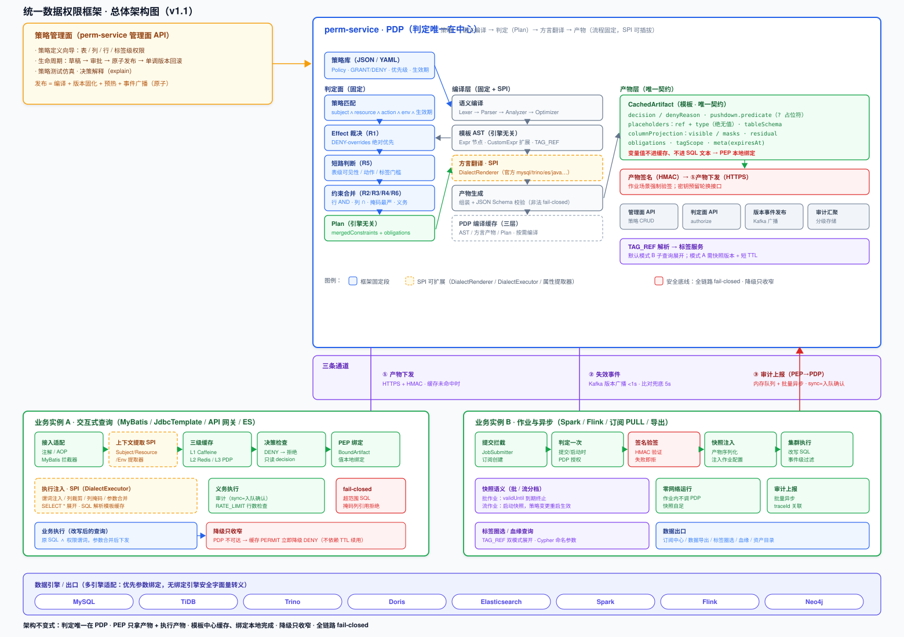
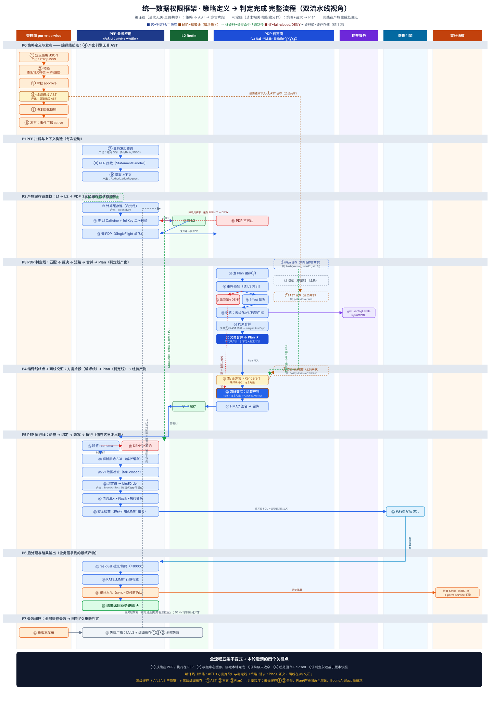
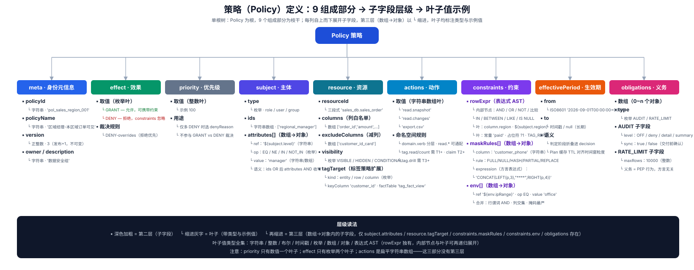

# 统一数据权限框架设计方案

**版本：v1.1（评审修订版）**
**定位：一个类似 Netty 的权限编程框架——流程固定，实现开放；开箱即用，亦可编程。**

---

## 0. 版本修订说明（v1.0 → v1.1）

本版在 v1.0 基础上，经四轮评审修订，核心变更如下：

| 编号 | 变更 | 性质 |
|---|---|---|
| C1 | 绑定值生命周期切分：缓存键含稳定属性指纹；缓存值只含模板（placeholders 仅 ref/type）；bindOrder 由 PEP 每次请求绑定生成 BoundArtifact | 修正 |
| C2 | 判定层六条规则完整定义（Effect 冲突 / 行谓词 / 列可见 / 掩码 / 短路 / 跨属性引用） | 新增 |
| C3 | 等级命名体系拆分：SENSITIVITY L0~L4、表级可见性枚举、tagLevel T0~T3 | 修正 |
| C4 | 降级策略：PDP 不可达时缓存 PERMIT 立即降级 DENY，不依赖 TTL 续用 | 修正 |
| C5 | 编译时机：按需编译 + PDP 侧三层编译缓存 | 明确 |
| C6 | 参数绑定原则：优先参数绑定（含 Trino JDBC 路径）；ES / MongoDB 用安全字面量转义 | 修正 |
| C7 | v1 SQL 支持范围：单表、显式列清单、ORDER BY、LIMIT、SELECT *（产物携带 schema 展开）；JOIN/子查询/聚合/UNION/CTE/窗口函数 fail-closed | 明确 |
| C8 | MyBatis 兼容细则：缓存键论证修正、count SQL 豁免、插件顺序机制、BoundSql 参数追加 | 新增 |
| C9 | SQL 解析缓存：MyBatis 用 BoundSql 模板直接作键；AST 深拷贝方案 | 新增 |
| C10 | 同步审计语义：sync = 交付前入队确认，非阻塞写 Kafka | 修正 |
| C11 | residual 边界：v1 禁止 residual 过滤 + LIMIT 组合（fail-closed） | 明确 |
| C12 | 标签级权限全流程：双模式展开、快照语义、tagScope 产物扩展 | 新增 |
| C13 | Neo4j 方言：自定义 Renderer/Executor + Cypher 命名参数 | 新增 |
| C14 | 管理面：生命周期、审批、发布原子流程、回滚版本单调递增 | 新增 |
| C15 | 作业形态：提交时注入、快照语义、产物签名验签、批/流分档 | 新增 |
| C16 | 缓存键存储：hash 作索引 + fullKey 二次校验 | 明确 |
| C17 | 产物有效期：min(L1 TTL, expiresAt, 版本失效) | 明确 |
| C18 | §18 六项待裁决事项全部定稿 | 裁决 |
| C19 | Plan 缓存键补正为五元（= 产物键 − dialect；原三元键漏 resourceId/action，存在跨资源串 Plan 缺陷） | 修正 |
| C20 | 新增 §20 完整流程详解（8 阶段 38 步、每步产出、PEP/PDP 子流程、两套缓存对照、产出传递链） | 新增 |
| C21 | 分层缓存键：域内存在 user/group 型策略时，Plan/产物键追加 subjectIdsFingerprint（修正五元键对 user/group 型匹配维度的遗漏） | 修正 |
| C22 | resourceType 显式化：ResourceDef 增加 resourceType 枚举（TABLE/TAG，v2 扩展 FILE/API/TOPIC）；TAG 型 locator 匹配 v1 精确、前缀通配预留 | 新增 |
| C23 | 术语泛化对照：策略 DSL 概念层用实例容器/实例/属性/filter/projection/masking 表述，SQL 词汇标注为 mysql 方言落地；v1 不全面换词 | 新增 |
| C24 | 演进路线与实现形态：v2 预留 purpose 维度/策略编译决策图/resourceType 扩展/标签路径前缀通配；判定链用管道+短路实现，状态机用于生命周期与熔断 | 新增 |
| C25 | 新增《缓存体系设计 v1.0》独立文档（缓存体系设计-v1.0.md + 4 张 SVG）：§5 缓存机制的实现链路时序、数据结构、部署形态与设计权衡展开——三级缓存实现选型、键三段式与指纹构造、读写链路、键空间版本化（指针前移）、版本事件广播与比对实现、HMAC 签名、多实例部署方案、PDP 无状态集群内存模型 | 新增 |
| C26 | PEP 执行侧 4 张 SVG：①PEP内部逻辑分层全景（四层请求链 26 项内置逻辑 + 6 项常驻后台 + 右侧业务扩展 SPI 全清单）；②执行管线六阶段（Parser/Binder/Injector/Pruner/Executor/ResidualProcessor 的输入输出规则与可替换 SPI、decideAndRewrite 与 postProcess 分段、顺序契约与禁令）；③适配器与管线调用链路（MyBatis 时序 10 步：框架调适配器、适配器调管线两次、proceed 夹中间）；④PEP请求执行全链路（豁免/L1/L2/PDP/DENY 红支路/降级分支 + 左侧 fail-closed 边界 14 条） | 新增 |
| C27 | 新增《PEP 设计文档 v1.0》（PEP设计文档-v1.0.md）：PEP 完整设计说明——定位与部署形态（三条铁律）、32 项内置逻辑（四层请求链 + 常驻后台）、适配器与管线架构（PepAdapter/QueryContext/ExecutionPipeline 三层接口 + MyBatis 时序 10 步）、执行管线六阶段详解、三种执行方式、SPI 全清单（必写 1 + 渠道 3 + 执行链 7 + 辅助 2 + 表达式 1 + PDP 渲染器六件套）、使用手册（六步接入/生效机制/拦截范围/资源声明/混合接入示例/策略配置/启动验证）、fail-closed 边界 14 条、15 条设计要点速查、PEP-PDP 职责边界附录 | 新增 |
| C28 | 缺口盘点与规则补全（本次修订）：①整体缺口审查 22 项（上轮 A 类 10 项处置 + 本轮新暴露 10 项 N1~N10 + 优先级三档 P0/P1/P2）；②R-T 组跨库定稿修订：R-T4（展开位置前移标签服务内部）/R-T5（模式 B 删除，模式 A 反转唯一下推路径 + 新增校验式）/R-T6（snapshotVersion 必带）/R-T7（expandMode 改 list/verify）/R-T8（快照契约 + batchCheckMembers）/R-T9（语义 1 防线前移标签服务内部）+ 新增 R-T11（三层防线接入规范）/R-T12（存储与下推位置约束）；③R-R 组后置分页：R-R3 细化为"摘 LIMIT + 过滤后分页" + 新增 R-R7（后置分页语义：内存分页/fetch-until-full/三重上限/审计）/R-R8（实体列表分页）；④R-M 组冲突检测落地：R-M3 修订 + 新增 R-M7（九类检测 C1~C9 × 三级可判定性 × 三级处置）/R-M8（检测范围）；⑤R-Sec 组通道安全（A8）：新增 R-Sec5（mTLS 双向认证）/R-Sec6（对称→非对称签名体系改造，顺带解决 A9 作业密钥分发）/R-Sec7（nonce+时间戳防重放）/R-Sec8（L2 Redis ACL）；⑥新建 engine/ 目录开始实现主体链路逻辑（判定链/冲突消解/渲染/绑定/注入，无依赖 JS 核心引擎） | 修订 + 新增 |

---

## 1. 定位与核心原则

### 1.1 业务背景

某数据采集平台，业务流程：数据源接入 → 清洗打标 → 湖仓存储 → 数据订阅/消费。
数据出口：订阅中心（TiDB/Trino）、数据导出（TiDB）、API 网关（多引擎）、标签圈选（TiDB）、血缘查询（Neo4j）、资产目录（TiDB）、Spark/Flink 作业。

### 1.2 核心诉求

统一权限模型（一套策略覆盖所有出口）、表/列/行/标签级管控、多引擎适配（TiDB/Trino/ES/Doris/Spark/Flink/Neo4j）、多场景接入（MyBatis/JdbcTemplate/API 网关/作业提交）、性能开销 < 5%、可审计、可扩展、开箱即用。

### 1.3 核心原则（不变式）

1. **判定与执行分离**：判定唯一在 PDP（策略匹配、冲突消解、短路、合并、方言翻译）；PEP 只拿产物、执行产物，不参与任何决策
2. **缓存产物，不缓存能力**：本地只做"查缓存 → 绑定 → 注入 → 执行"，禁止在本地合成 Plan
3. **流程固定，实现开放**：拦截 → 缓存 → 决策 → 翻译 → 注入 → 义务的流程固定；方言翻译、上下文提取、执行产物可自定义
4. **产物 schema 是唯一契约**：翻译器输出必须符合 schema（JSON Schema 校验），执行器只认 schema；schema 变更向后兼容；自定义翻译器输出非法 = fail-closed
5. **模板与绑定分离（C1）**：缓存键含稳定属性指纹（仅限低基数、慢变、非 PII 属性）；缓存产物只含模板（placeholders 仅 ref/type，绝无 value）；bindOrder 由 PEP 每次请求绑定生成 BoundArtifact。变量值不进 PDP 缓存、不进 SQL 文本（有绑定能力的引擎）
6. **降级只收窄**：任何异常路径默认 DENY
7. **fail-closed**：任何环节失败默认拒绝

---

## 2. 整体架构

> **总体架构图（v1.1）**：涵盖 策略管理面 → PDP → 三条通道 → PEP 双形态 → 多引擎 全链路。若 Markdown 渲染器不支持内嵌 SVG，可直接用浏览器打开 `架构图.svg`。



### 2.1 分层架构

```
┌────────────────────────── 固定段（框架核心，用户不可动）─────────────────────────┐
│  策略层：策略定义 JSON/YAML；Policy / SubjectDef / ResourceDef / Constraints       │
│  编译层：Lexer → Parser → Analyzer → Optimizer → 模板 AST（引擎无关）             │
│  判定层：策略匹配 / Effect 裁决 / 短路 / 约束合并 / 义务合并 → Plan                │
│  产物层：产物 schema（唯一契约）；CachedArtifact（模板）/ BoundArtifact（绑定后）   │
│  基础设施：三级缓存 / 版本失效 / 单飞 / 熔断 / 降级 / 审计上报                     │
└───────────────────────────────────────────────────────────────────────────────────┘
                                        │ 产物 JSON
                                        ▼
┌────────────────────────── 可变段（SPI，用户可编程）──────────────────────────────┐
│  中心 perm-service（PDP）：DialectRenderer（官方 mysql/trino/es/java，用户自定义）  │
│  本地业务进程（PEP）：DialectExecutor（官方 mybatis/jdbc/es/spark/flink）、        │
│                      SubjectAttributeExtractor / ResourceAttributeExtractor /     │
│                      EnvironmentExtractor                                         │
└───────────────────────────────────────────────────────────────────────────────────┘
```

### 2.2 三条通道

| 通道 | 协议 | 频率 | 说明 |
|---|---|---|---|
| 判定/产物 | HTTPS + HMAC 签名 | 缓存未命中 | 返回 CachedArtifact（模板） |
| 失效事件 | Kafka / Redis Pub/Sub | 策略变更时 | 版本号广播 |
| 审计上报 | Kafka / HTTP | 批量异步 | 分级上报 |

### 2.3 多实例一致性

| 机制 | 说明 |
|---|---|
| 事件广播 | 所有实例订阅版本变更，收到即本地失效 |
| 版本比对 | 后台定时 5s + L2 Redis 比对（不做每请求比对） |
| TTL | 仅作正常情况下的自然过期，不作降级续用 |
| 降级 | PDP 不可达 → 缓存 PERMIT 立即 DENY，DENY 保持 |

---

## 3. 核心数据结构

### 3.1 策略模型

```java
public class Policy {
    private String policyId;
    private String policyName;
    private int version;
    private int priority;              // 仅作 denyReason 选择与展示/审计元数据
    private Effect effect;             // GRANT / DENY
    private SubjectDef subject;
    private ResourceDef resource;
    private Set<String> actions;
    private Constraints constraints;   // v1：DENY 策略的 constraints 忽略
    private List<Obligation> obligations;
    private EffectivePeriod effectivePeriod;
    private Map<String, Object> meta;
}
```

- **resourceType（C22）**：`ResourceDef.resourceType` 显式枚举 `TABLE / TAG`（v2 扩展 FILE/API/TOPIC）；`locator` 按类型解释——TABLE 为三段式 `ns.db.table`（段内 `*` 通配，只用于匹配不用于裁决），TAG 为标签路径（v1 精确匹配，前缀通配预留）

### 3.2 命名体系（C3）

三套等级体系严格分离，禁止混用数字方向：

| 体系 | 命名 | 方向 |
|---|---|---|
| 列/资源敏感级 | `SENSITIVITY L0 ~ L4` | 数字越大越敏感（与原型 UI 一致） |
| 表级可见性 | 枚举 `VISIBLE / HIDDEN / CONDITIONAL` | 不用数字 |
| 用户标签权限 | `tagLevel T0 ~ T3`（none / read / count / claim / drill） | 数字越大权限越强 |

### 3.3 AST 标准模型（同 v1.0）

基础节点：AND/OR/NOT、EQ/NE/GT/GE/LT/LE、IN/BETWEEN/IS_NULL/LIKE、FUNCTION_CALL、FIELD_REF/VARIABLE_REF/LITERAL/TAG_REF、CUSTOM。扩展走 `CustomExpr`。

### 3.4 AuthorizationRequest

```java
public class AuthorizationRequest {
    private String userId;
    private Set<String> roles;
    private String resourceId;
    private String action;
    private String engine;
    private Map<String, Object> subjectAttrs;
    private Map<String, Object> resourceAttrs;
    private Map<String, Object> envAttrs;
}
```

### 3.5 产物 schema（v1.1 修订版，唯一契约）

```json
{
  "artifactVersion": "1.0",
  "dialect": "mysql",
  "accessType": "mybatis",
  "artifactId": "a1b2c3d4",
  "planVersion": "v1",
  "decision": "PERMIT",
  "denyReason": null,

  "pushdown": {
    "predicate": "(`status` = 'paid' AND `region` = ?)",
    "placeholders": [
      { "index": 0, "ref": "subject.region", "type": "varchar" }
    ],
    "columnProjection": {
      "visible": ["order_id", "amount", "region", "status", "customer_phone"],
      "masks": [
        { "column": "customer_phone", "rule": "PARTIAL",
          "expression": "CONCAT(LEFT(`customer_phone`,3),'****',RIGHT(`customer_phone`,4))" }
      ]
    },
    "tableSchema": {
      "columns": ["order_id", "amount", "region", "status", "customer_phone", "customer_id_card"]
    }
  },

  "residual": {
    "predicateAst": { },
    "masks": [],
    "filters": []
  },

  "obligations": [
    { "type": "AUDIT", "level": "detail", "sync": true },
    { "type": "RATE_LIMIT", "maxRows": 10000 }
  ],

  "tagScope": null,

  "meta": {
    "compiledAt": 1758000000000,
    "expiresAt": 1758001800000
  }
}
```

**关键约束（C1）**：
- `placeholders` 只含 ref/type 元数据，**绝无值**
- `bindOrder`（含值的绑定列表）只存在于 **BoundArtifact**，由 PEP 绑定环节生成，不进缓存、不出 PDP
- `tableSchema` 用于 PEP 展开 `SELECT *`（见 8.3），列数多时可按需裁剪为"全列名清单"
- 标签快照数据是唯一允许"值进产物"的例外，必须携带 `tagScope.snapshotVersion`（见 10.4）
- `residual` 用 AST 回退，保证跨方言统一

---

## 4. 判定层规则（C2，能力本体）

### 4.1 判定流程

```
Step 1  策略匹配：subject ∧ resource ∧ action ∧ env 条件 ∧ effectivePeriod 全部满足
        → matchedPolicies；无匹配 → DENY(fail-closed)
Step 2  Effect 裁决（R1）
Step 3  短路判断（R5）
Step 4  约束合并（R2/R3/R4/R6）→ mergedConstraints
Step 5  义务合并 → mergedObligations
输出    Plan（引擎无关判定计划）
```

### 4.2 R1：Effect 冲突消解

```
1. 任一 DENY 策略匹配 → 整体 DENY（DENY-overrides，绝对优先，不看 priority）
2. 否则任一 GRANT → PERMIT，继续合并
3. 无匹配 → DENY（fail-closed）
```

- priority **不参与** DENY vs GRANT 裁决；仅用于：多 DENY 时选 denyReason（取 priority 最高者）
- specificity（资源 > 主体 > 环境）**v1 删除**——交集合并语义下无消费方，避免死规则
- v1 中 DENY 策略的 constraints 字段**忽略**（DENY = 无条件整体拒绝）；"减列/减行"语义在单条 GRANT 策略内用 excludeColumns / 谓词表达

### 4.3 R2：多策略行谓词合并

- 所有 GRANT 策略非空 rowExpr 做 **AND 连接**（交集收窄，符合最小权限）
- 某策略 rowExpr 为空 → 跳过；全部为空 → null（无行级约束）
- 变量保持符号形式（`${subject.region}`），PDP 编译期只校验引用存在性与类型

### 4.4 R3：列可见集合合并

```
1. visibleColumns 交集（某策略为空 → 跳过；全部为空 → null = 全部可见）
2. 减去所有策略 excludeColumns 的并集
3. 结果为空 → EMPTY_SET → PEP 拒绝
```

### 4.5 R4：掩码冲突消解

- 最严格优先：`FULL > NULL > HASH > PARTIAL > REPLACE`（按信息暴露程度从低到高）
- **"未提及 ≠ 放行"**：一列在任一策略被掩码，最终即掩码；不存在"显式明文放行"语义
- FULL 掩码列强制从 visible 中剔除
- **掩码列被查询谓词引用 → fail-closed**：检测位置在 **PEP**（ColumnMaskApplier/PredicateInjector 解析原始 SQL 时），检查 WHERE / GROUP BY / ORDER BY / JOIN ON，命中即拒绝

### 4.6 R5：短路条件

| 顺序 | 检查项 | 不通过 → |
|---|---|---|
| 1 | 策略匹配（Step 1 已做） | DENY |
| 2 | 表级可见性 = HIDDEN | DENY |
| 3 | 动作权限（无 GRANT 允许该 action，支持 `read.*` 通配符，`*` 不跨段） | DENY |
| 4 | 标签门槛（tagLevel 不足） | DENY |
| — | 环境条件不满足 | 非短路：该策略不适用，继续匹配其他策略 |

- 表级可见性来源优先级：用户级策略 → 角色级策略 → 资源密级兜底 → 默认 VISIBLE
- 动态 env（如时间窗口）在 PDP 判定期**折叠进 decision**，不进缓存指纹

### 4.7 R6：跨属性引用

- 多策略引用不同属性来源（subject/env/resource）→ AND 连接；语义为同时满足，不等则空结果（正常返回空，不报错）
- 变量解析分工（修正）：**PDP 编译期**校验 ref 存在性与类型（合法命名空间、类型已知），失败 fail-closed；**值**由 PEP 绑定环节从上下文中解析，失败 fail-closed

### 4.8 义务合并

- 并集 + 同类型取最强：AUDIT 取最高级别（detail > basic）、RATE_LIMIT 取 min(maxRows)

---

## 5. 缓存机制

### 5.1 三级缓存

| 层级 | 实现 | 容量 | 延迟 |
|---|---|---|---|
| L1 | Caffeine（进程内） | 5 万 | 100ns |
| L2 | Redis（分布式） | 100 万 | 1~5ms |
| L3 | perm-service（权威） | 全量 | 10~50ms |

### 5.2 缓存键（C1/C16）

```
cacheKey = hash(
  planVersion,            // 策略版本号
  dialect,                // 目标引擎
  resourceId,             // 资源ID
  action,                 // 动作
  rolesFingerprint,       // hash(roles 集合)
  stableAttrFingerprint   // hash(低基数、慢变、非 PII 的稳定属性，如数据域)
)
```

- **Plan 缓存键 = 产物键 − dialect（五元，C19）**：判定匹配条件含 resource/action，Plan 键必须含这两个维度；详见 6.1 与 20.7
- **分层键（C21）**：user/group 型策略的匹配维度（userId/groups）不在基础键内；当 L3 索引显示该 resource/action 域存在 user/group 型 active 策略时，Plan 键与产物键追加 `subjectIdsFingerprint = hash(userId, sorted(groups))`（Plan 五元→六元、产物六元→七元），否则维持基础键——避免 userId 高波动拉低全局命中率
- **stableAttr 入选标准**：低基数、慢变、非 PII。波动属性一律走模板占位 + PEP 运行时绑定
- 存储：hash 作索引，条目为 `CacheEntry { fullKey, artifact }`，**命中后 fullKey 二次校验**，碰撞视为未命中

### 5.3 失效与降级（C4）

| 机制 | 延迟 | 用途 |
|---|---|---|
| 事件失效 | < 1s | 主通道，收到即本地失效 |
| 版本比对 | 5s | 后台定时 + L2 Redis 比对（不做每请求比对） |
| TTL | 30s | 仅正常自然过期 |

**降级规则**：PDP 不可达 → 缓存中 PERMIT **立即降级 DENY**、DENY 保持、未命中 DENY。不依赖 TTL 续用（策略收紧后的越权窗口不可接受）。

### 5.4 并发控制

缓存击穿 → 单飞（SingleFlight）；缓存雪崩 → TTL 抖动（30s ± 5s）；缓存穿透 → 缓存空结果（DENY）；失效风暴 → 延迟失效 + 分批预热 + 只失效收窄；Thundering Herd → 熔断 + 降级。

### 5.5 产物有效期（C17）

`effectiveExpiry = min(L1 TTL, 产物 meta.expiresAt, 版本失效时间)`。

---

## 6. 编译时机与 PDP 内部流程

### 6.1 编译时机（C5）

**按需编译 + PDP 侧三层编译缓存**（不做全组合预编译，避免笛卡尔积爆炸）：

```
1. AST 缓存：策略 → 模板 AST       键 = policyId:version    策略变更时失效
2. 方言产物缓存：AST + dialect → 产物  键 = policyId:version:dialect  策略变更时失效
3. Plan 缓存：策略 + 请求指纹 → Plan  键 = hash(planVersion, resourceId, action, rolesFingerprint, stableAttrFingerprint)
                                    （五元，C19：Plan 键 = 产物键 − dialect；原三元键漏 resourceId/action，存在跨资源串 Plan 缺陷）
                                    分层键（C21）：域内存在 user/group 型策略时追加 subjectIdsFingerprint，见 5.2
                                    短 TTL 或事件失效
```

### 6.2 PDP 判定流程（缓存未命中时）

```
1. 策略匹配（含 action/env/effectivePeriod）→ matchedPolicies
2. 无匹配 → DENY
3. Effect 裁决（DENY-overrides）
4. 短路判断（表级/动作/标签门槛）
5. 约束合并 → Plan
6. 方言翻译（DialectRenderer，可自定义）→ 模板谓词 + placeholders
7. 产物生成（CachedArtifact，仅模板）→ 返回
```

- 时间窗口等动态 env：在判定阶段折叠进 decision；Plan 缓存 TTL 须小于时间窗口粒度或做边界对齐，防止过期缓存复用

---

## 7. 路由机制与引擎适配矩阵

### 7.1 双层路由

- 第一层（PDP）：`dialect → DialectRenderer`
- 第二层（PEP）：`dialect + accessType → DialectExecutor`
- dialect 解析优先级：注解 engine → 资源注册表 → 接入方式推断 → 全局配置 → fail-closed

### 7.2 参数绑定能力矩阵（C6）

原则：**优先参数绑定；无绑定能力的引擎使用安全字面量转义渲染。**

| 类别 | 引擎 | 处理 |
|---|---|---|
| A 类（可绑定） | MySQL / TiDB / Doris；Trino JDBC（`?` + setXxx）；Spark / Flink 视接入方式（JDBC 可绑定，SQL 文本执行需转义） | `?` 占位符 + 参数绑定 |
| B 类（无绑定） | ES / MongoDB | 安全字面量转义 |
| C 类（部分支持） | 某引擎特定语法不支持绑定 | 降级到安全字面量转义 |

安全字面量转义规则：字符串 `'`→`''`、`\`→`\\`、控制字符转义；数值走 BigDecimal.toPlainString；日期时间规范化格式。ES 的 term query 为 JSON 结构化无需转义，wildcard/regexp 需转义 `* ?` 与正则元字符。**Cypher 使用命名参数（`$name`），Neo4jExecutor 负责 bindOrder 位置参数 → 命名参数 map 的转换。**

### 7.3 官方内置路由矩阵（v1.1 扩展）

| dialect | accessType | 官方实现 |
|---|---|---|
| mysql / tidb | mybatis / jdbc | MysqlRenderer + MybatisExecutor / JdbcExecutor |
| trino | jdbc | TrinoRenderer + JdbcExecutor |
| es | es | EsRenderer + EsExecutor |
| java | spark / flink | JavaRenderer + SparkExecutor / FlinkExecutor |
| neo4j | cypher | Neo4jRenderer + Neo4jExecutor |

---

## 8. v1 支持范围与 fail-closed 边界（C7）

### 8.1 v1 支持的 SQL 形态

- 单表 SELECT、简单 WHERE（AND/OR/比较/IN/LIKE/BETWEEN/IS NULL）、显式列清单、单表 ORDER BY、单表 LIMIT、`SELECT *`

### 8.2 v1 不支持（fail-closed）

JOIN、子查询、聚合（COUNT/SUM/GROUP BY/HAVING）、UNION、CTE、窗口函数。超范围报错明确：`UnsupportedSqlException: 当前查询包含不支持的特性：[JOIN]。请拆分为单表查询，或联系管理员配置自定义 Renderer。`

**边界声明**：支持范围检查**只针对原始业务 SQL**；权限谓词由 PDP 生成、视为可信、豁免检查（含标签子查询模式 B 注入的 `IN (SELECT ...)`）。

### 8.3 SELECT * 的展开（C7）

PEP 用产物 `pushdown.tableSchema` 展开 `*`：`*` → visibleColumns 交集 → 掩码列替换表达式。schema 来源优先级：产物携带（推荐）→ 本地缓存（定期同步）→ information_schema 实时查。

### 8.4 其他 fail-closed 边界

- 掩码列被 WHERE/GROUP BY/ORDER BY/JOIN ON 引用 → 拒绝（PEP 检测）
- residual 过滤 + LIMIT 组合 → 拒绝（见 13）
- 审计队列满（严格合规档）→ 拒绝交付
- 变量无法解析（PDP 编译期 / PEP 绑定期）→ 拒绝
- 产物 schema 非法 / 签名校验失败 → 拒绝
- 方言无法解析 → 拒绝

---

## 9. 接入细则

### 9.1 MyBatis 接入（C8）

- **拦截点**：`StatementHandler.prepare`，通过 `SystemMetaObject` 取 `delegate.configuration`（注意：BoundSql 上**没有** configuration 字段）
- **参数追加**：权限谓词注入在原 WHERE 之后（权限 `?` 位于原 SQL 所有 `?` 之后），ParameterMapping 追加到 `parameterMappings` 末尾，值放入 `additionalParameters`，顺序天然正确
- **缓存**：MyBatis CacheKey 在 `Executor.query` 阶段基于**原始 SQL** + 原参数计算（早于 PEP 改写），改写不影响缓存键 → **必须禁用二级缓存 + `local-cache-scope: statement`**（否则同一 SqlSession 内不同权限上下文串数据）
- **插件顺序**：MyBatis 插件顺序由 InterceptorChain 注册顺序决定，`@Order` 无效；需在自动配置中显式排序
- **PageHelper count SQL 豁免**：PageHelper 派生的 `SELECT count(0) ...` 是聚合查询，按 8.2 会被 fail-closed 拒绝 → 必须对 count 查询豁免（仅注入行谓词，不做列裁剪/掩码检查）
- **掩码列引用检测**：在 PEP 解析原始 SQL 后执行（见 4.5）

### 9.2 SQL 解析缓存（C9）

- **MyBatis 场景**：`BoundSql.getSql()` 本身就是参数化模板，**直接作缓存键**，命中率 ~100%，无需归一化
- **JDBC 裸文本场景**：字面量归一化（`'...'` → `?`、数字 → `?`）后作模板键
- **AST 深拷贝**：JSqlParser 无 clone API，命中缓存后需自建 AST 复制（deparse + reparse 或 AST 复制器），避免 PEP 改写污染缓存

### 9.3 同步审计（C10）

- sync 语义 = **交付前入队确认**（内存 offer，微秒级），不是"已写入 Kafka"；写 Kafka 由独立线程批量异步完成
- 本地队列容量 10000，满时按合规档分档：严格合规 fail-closed（拒绝交付）；一般合规丢弃 + 告警；可选 WAL 持久化兜底

---

## 10. 标签级权限（C12）

### 10.1 权限维度（tagLevel T0~T3）

| 维度 | 所需 tagLevel |
|---|---|
| 标签可见性 tag.read / 计数 tag.count | T1+ |
| 标签圈选 tag.claim | T2+ |
| 标签下钻 tag.drill | T3+ |

### 10.2 实现机制总览：三层叠加，主体是谓词下推

标签级权限**不是单一机制**，而是三层叠加：

| 层 | 机制 | 位置 | 产出 |
|---|---|---|---|
| ① 准入判定 | 标签门槛短路（R5-4）：用户 tagLevel vs 动作所需等级 | PDP 判定层 | DENY / PASS（非谓词） |
| ② 数据范围 | TAG_REF → 谓词翻译，随产物**谓词下推**到引擎 | PDP 翻译层 | pushdown.predicate + tagScope |
| ③ 兜底 | 引擎无法下推时转 residual 内存过滤 | PEP 执行层 | 结果集上限 10000，超限 fail-closed |

### 10.3 两种权限语义（决定谓词约束哪个维度，必须区分）

**语义 1：约束标签维度（"能圈选哪些标签"）**
业务查询标签事实表（tag_fact_view），权限保证用户不能圈选/下钻其无权标签。权限谓词约束 **tag_path**：

```sql
-- 原始业务 SQL（圈选黑名单标签）
SELECT entity FROM tag_fact_view WHERE tag_path = ?
-- 注入权限谓词（用户有权标签白名单）
... AND tag_path IN (?, ?, ...)
```

**语义 2：约束实体维度（"标签作为数据权限维度"）**
业务查询普通数据表（如订单表），策略用 TAG_REF 表达"仅可见某标签成员的实体数据"。权限谓词约束 **entity**：

```sql
-- 原始业务 SQL
SELECT * FROM sales_order WHERE order_date >= ?
-- 注入权限谓词（TAG_REF 展开）
... AND entity IN (SELECT entity FROM tag_fact_view WHERE tag_path = ?)
```

- 语义 1 实现简单：解析用户有权标签列表 → 生成 `tag_path IN (?,...)` 谓词；白名单是权限数据（慢变），无成员动态性问题
- 语义 2 是 10.5 双模式展开的主场景：TAG_REF 需解析标签**成员**

### 10.4 解析位置

标签引用（TAG_REF）在 **PDP 翻译阶段**解析：调标签服务 `getEntities(tagPath)`，展开为实体列表或子查询。标签服务不可用 → 结果缓存 + 不可用时 fail-closed（或显式配置的降级策略）。

### 10.5 双模式展开（语义 2 的谓词下推方式）

**模式 A：实体列表展开（小标签，实体数 < 1000）**
`entity IN (?, ?, ?, ...)`，实体列表随产物下发。**默认禁用**（见 §18 裁决 C），需显式开启并携带 snapshotVersion。

**模式 B：子查询展开（大标签，默认推荐）**
`entity IN (SELECT entity FROM tag_fact_view WHERE tag_path = ?)`——动态性交给引擎侧实时解析，**默认采用模式 B**。

**为什么谓词下推而非 PEP 内存过滤**：标签成员可达百万级，拉回内存过滤是性能灾难；下推后引擎可利用 tag_fact_view 的 tag_path/entity 索引过滤。与 §8.2"v1 不支持子查询"的关系：该限制只针对**原始业务 SQL**，权限谓词由 PDP 生成、视为可信、豁免检查。

### 10.6 快照语义（C12，安全边界）

- 标签成员是动态数据：模式 A 产物必须携带 `tagScope.snapshotVersion` + 短 TTL（与标签服务快照对齐），并显式声明"快照语义、成员变更延迟可见"的上限；模式 B 天然无此问题
- 实体列表是唯一允许"值进产物"的例外，必须带快照版本号
- 模式 B 的额外优势：产物中只有 `tag_path = ?` 占位模板，**PDP 产物缓存不受成员变化影响**，成员实时性由引擎侧查询时保证

### 10.7 产物扩展字段

```json
"tagScope": {
  "tagPath": "业务域/风控/黑名单",
  "level": 2,
  "canDrillDown": false,
  "expandMode": "subquery",
  "snapshotVersion": "ts-20260917-001"
}
```

### 10.8 标签权限来源

用户 tagLevel 来源于同一 Policy 模型（用 action 命名空间 `tag.*` 表达），支持用户级 → 角色级 → 标签继承逐级解析，默认 T0。

### 10.9 完整链路示例（语义 2 + 模式 B）

```
1. 业务查询：SELECT order_id, amount FROM sales_order WHERE order_date >= ?
2. PEP 拦截 → AuthorizationRequest{userId, action="tag.claim", resourceId, subjectAttrs{tagLevels}}
3. PDP 判定：R5-4 标签门槛 → tagLevel=T1 < claim 所需 T2 → DENY（短路，到此为止）
   （若 tagLevel=T2 → PASS，继续）
4. PDP 翻译：策略 rowExpr 含 TAG_REF("业务域/风控/黑名单")
   → 模式 B 生成谓词模板：
     entity IN (SELECT entity FROM tag_fact_view WHERE tag_path = ?)
   → placeholders: [{ref: "tagScope.tagPath", type: "varchar"}]（模板，无成员列表值）
   → tagScope: {tagPath, level, expandMode: "subquery"}
5. 产物下发（仅模板）→ PEP 绑定 tagPath 值 → 注入 WHERE → 引擎执行（成员实时解析）
6. 义务：圈选/下钻动作默认 sync 审计（交付前入队确认）
```

### 10.10 标签服务接口与降级

| 接口 | 用途 | 调用方 |
|---|---|---|
| `getEntities(tagPath)` | 模式 A 展开 | PDP 翻译阶段 |
| `getUserTagLevels(userId, tagPaths)` | R5-4 门槛判定 | PDP 判定阶段 |

- 标签服务不可用：PDP fail-closed（默认）；可显式配置"短缓存续用"降级（须声明快照版本）
- 成员查询结果在 PDP 侧短缓存（仅模式 A 场景），键含 tagPath + snapshotVersion

### 10.11 方案对比（为什么最终选谓词下推）

| 方案 | 性能 | 跨引擎 | 实时性 | 结论 |
|---|---|---|---|---|
| 谓词下推（模式 A/B） | 引擎索引过滤 ✅ | 靠 Renderer 翻译 ✅ | B 实时 / A 快照 | **v1 采用** |
| PEP 内存过滤（residual） | 全量拉回，灾难 ❌ | 无需翻译 ✅ | 实时 | 仅兜底 + 结果集上限 |
| 预计算实体快照表 | 依赖 ETL 延迟 ❌ | 需各引擎建表 ❌ | 延迟 | 不采用 |
| 引擎侧 UDF | 好 | 每引擎实现 UDF ❌ | 好 | 不采用，违背"翻译在 PDP" |

---

## 11. Neo4j 血缘出口（C13）

- 官方提供 `Neo4jRenderer`（AST → Cypher 谓词）+ `Neo4jExecutor`（accessType=cypher），路由矩阵已扩展（见 7.3）
- **Cypher 参数化**：谓词用命名参数 `$param`，Neo4jExecutor 将 bindOrder（位置语义）转换为命名参数 map；**禁止内联字面量**
- 兜底方案：血缘结果集通常较小，可转 residual 内存过滤（有性能风险，需结果集上限）

---

## 12. 审计与义务

### 12.1 审计通道

PEP 本地内存队列（10000）→ 独立线程批量写 Kafka（每批 ≤ 100）→ perm-service 汇聚。分级：basic / detail；时机：sync（交付前入队确认）/ async（尽力入队）。

### 12.2 义务类型（v1）

AUDIT（级别、时机）、RATE_LIMIT（maxRows，PEP 事后检查返回行数，超限告警或拒绝）、NOTIFY（敏感数据访问告警，预留）。

---

## 13. residual 语义（C11）

### 13.1 执行顺序（v1 修正版）

```
1. pushdown 下推到引擎（含原 LIMIT）
2. 引擎执行
3. residual 掩码（不影响行数，安全）
```

**v1 禁止 residual 过滤 + LIMIT 组合**：PEP 检测到 `residual.hasFilter() && stmt.getLimit() != null` → fail-closed（拒绝并提示拆分查询）。residual 过滤场景仅允许出现在无 LIMIT 的查询中（全量拉取后内存过滤）。

### 13.2 保护措施

- 结果集上限 10000 行，超限 fail-closed（防性能灾难）
- PEP 内置**引擎无关 AST 求值器**组件，执行 residual 过滤与掩码
- 外部查询（residual.filters）批量请求，禁止逐行调用

---

## 14. 管理面（C14）

### 14.1 策略生命周期

`draft → pending → approved → active → disabled → archived`（pending 可 → rejected）

### 14.2 核心 API（/api/perm/admin）

createDraft / updateDraft / validate / submit / approve / publish / disable / rollback / getVersions

### 14.3 存储（三表）

- `perm_policy`（policy_id, policy_name, current_version, status, timestamps）
- `perm_policy_version`（policy_id, version, policy_json, status, created_by, approved_by, UNIQUE(policy_id, version)）
- `perm_approval_record`（policy_id, version, approver_id, action, comment）

### 14.4 发布流程（原子）

校验（语法/语义/冲突检测）→ 编译（AST + 方言产物）→ 版本固化 → 缓存预热 → 事件广播 → status=active。任一步失败全量回滚（status 保持 approved）。

**回滚语义**：`rollback(id, version)` = 发布一个"内容等于历史版本"的**新版本**，保证版本号单调递增（缓存键 planVersion 语义不被破坏）。

---

## 15. Spark / Flink 作业形态（C15）

### 15.1 与交互式查询的差异

| 维度 | 交互式查询 | 作业 |
|---|---|---|
| 判定时机 | 每次查询 | 提交/启动时一次 |
| 产物传递 | HTTP 拉取 | 序列化注入 + **签名验签** |
| 策略变更 | 立即生效 | 批：快照至 validUntil；流：重启生效 |
| 网络依赖 | 缓存未命中时 | 零网络 |

### 15.2 提交流程

提交器拦截 → 构造 AuthorizationRequest → PDP 获取产物（一次）→ **产物签名** → 序列化注入作业配置 → 提交集群 → 作业内**验签 + 解码** → 改写 SQL/过滤 → 执行。

### 15.3 安全（C15，P0 级）

**产物必须签名验签**：作业配置经用户可控通道传递，未验签的产物可被篡改（改 decision/predicate 绕过权限）。v1 方案：PDP 用共享密钥 HMAC 签名产物，验签逻辑内置在作业执行器（SparkJobExecutor / FlinkPermissionFilter）中，验签失败即拒绝执行。密钥管理与轮换策略见 §18 裁决 A。

### 15.4 有效期分档（C15）

- **批作业**：`validUntil` 到期强制终止（运行时长有限，可接受）
- **流作业**：启动时快照，**运行期不强制过期**（策略变更下次重启生效）；禁止把 validUntil 套在长流作业上（否则流作业每 30min 必挂）

### 15.5 jobContext 产物扩展

```json
"jobContext": {
  "snapshotSemantics": true,
  "validFrom": 1758000000000,
  "validUntil": null,
  "submitter": "zhang",
  "resourceId": "sales_db.sales_order",
  "signature": "hmac-sha256:xxxx"
}
```

- Flink 权限过滤优先 SQL 注入下推（源表视图 WHERE）；事件级 FilterFunction 仅作兜底
- 作业产物中 bindOrder 含提交时绑定值（快照语义，合理），与交互式查询的模板分离原则不冲突

---

## 16. 可扩展点（不变）

| 自定义点 | 位置 | 接口 | 粒度 |
|---|---|---|---|
| 方言翻译 | PDP | DialectRenderer | 粗/中/细（ExprVisitor / FunctionMapper / IdentifierQuoter / TypeConverter / LiteralRenderer / PlaceholderRenderer） |
| 上下文提取 | PEP | SubjectAttributeExtractor / ResourceAttributeExtractor / EnvironmentExtractor | 中 |
| 执行产物 | PEP | DialectExecutor | 粗/中/细（QueryParser / PredicateInjector / ColumnMaskApplier / ColumnPruner / ParamBinder / ResidualProcessor） |

其他：PepAdapter / ObligationExecutor / ArtifactDecoder / AuditReporter / ResidualFilter。

---

## 17. 双模式使用（不变）

- **开箱即用**：`perm-spring-boot-starter-mysql` + `@RequireDataPermission(resource, action)` 注解，自动使用官方 Renderer/Executor/提取器
- **编程框架**：实现 DialectRenderer / DialectExecutor / 属性提取器 SPI 注册即可
- **混合模式**：官方 Renderer + 自定义 FunctionMapper 等细粒度扩展

---

## 18. 已裁决事项（定稿）

| 编号 | 事项 | 裁决结果 |
|---|---|---|
| A | 产物签名方案 | v1 用 HMAC 共享密钥签名；预留密钥轮换接口；作业场景强制验签，HTTP 通道产物同样签名 |
| B | 流作业有效期 | 启动快照、运行期不强制过期；策略变更下次重启生效 |
| C | 标签模式 A 快照 TTL | 默认禁用模式 A（强制子查询模式 B）；确需模式 A 时须显式声明 snapshotVersion 与短 TTL 对齐 |
| D | SELECT * 支持 | v1 支持（产物携带 schema 展开） |
| E | 审计队列满 | 分档：严格合规 fail-closed；一般合规丢弃 + 告警 |
| F | 掩码严格序 | 固定 FULL > NULL > HASH > PARTIAL > REPLACE 为默认，预留配置位 |

---

## 19. 一句话总结

这是一个类似 Netty 的权限编程框架：框架固定"策略 → AST → 判定 → 翻译 → 缓存 → 审计"的完整流程，开放"方言翻译、上下文提取、执行产物"三个自定义点。核心契约是产物 schema（模板），核心原则是"流程固定，实现开放；决策在 PDP，执行在 PEP；模板中心缓存，绑定本地完成；降级只收窄，超范围 fail-closed"。

---

## 20. 完整流程详解（C20）

> 全流程泳道 SVG：`权限校验全链路.svg`（8 阶段 38 步、双流水线视角、含产出标注与两套缓存桶）。本节为文字版，实现时以本节为流程依据。



### 20.1 三条流水线总览

```
编译线（请求无关·全员共享）      判定线（请求相关·按指纹分群）      执行线（每次请求）
策略 → AST → 方言片段            策略+请求 → Plan                   产物 → 绑定 → 改写 → 执行
 ①AST缓存  ②方言片段缓存            ③Plan缓存                        L1/L2 产物缓存
└────────── PDP 内部（三层编译缓存）──────────┘      └──────── PEP 侧（三级缓存链）────────┘
```

- **编译线**只与（策略版本 × 方言）相关，每组合一生一次，全员共享
- **判定线**与请求上下文相关（角色、稳定属性），同角色群体共享
- **执行线**每次请求发生，值绑定只是内存操作
- 两线在产物组装处交汇：`CachedArtifact = 方言片段（编译线）+ Plan（判定线）`

### 20.2 分阶段步骤与产出

**P0 策略定义与发布（管理面，编译线起点）**

| 步骤 | 动作 | 产出 | 缓存读写 |
|---|---|---|---|
| ① | 定义策略 JSON（9 部分：effect/subject/resource/actions/constraints/obligations/period/priority/meta） | Policy JSON | — |
| ② | 校验：语法（解析 AST）/语义（变量命名空间/类型）/冲突检测 | 校验报告 | — |
| ③ | 审批（pending → approved，可 rejected） | 状态流转 | — |
| ④ | **编译模板 AST**（Lexer→Parser→Analyzer→Optimizer） | **引擎无关 AST** | **写编译缓存①**（键 policyId:version） |
| ⑤ | 版本固化（不可变快照入 perm_policy_version，版本单调递增） | 版本快照 | — |
| ⑥ | 原子发布：预热 → 事件广播 → active（任一步失败全量回滚） | active 状态 | 可选预热热门方言 → 编译缓存② |

**P1 PEP 拦截（每次查询）**

| 步骤 | 动作 | 产出 |
|---|---|---|
| ⑦ | 业务发起查询（MyBatis Mapper / JDBC，业务无感知） | 原始 SQL |
| ⑧ | PEP 拦截（StatementHandler.prepare；@Order 对插件无效，靠注册顺序） | 拦截点 |
| ⑨ | 三个 SPI 提取器构造上下文 | **AuthorizationRequest** |

**P2 产物缓存链查找（三级缓存读取顺序）**

| 步骤 | 动作 | 产出 | 命中则 |
|---|---|---|---|
| ⑩ | 计算六元组缓存键 | cacheKey | — |
| ⑪ | 查 L1 Caffeine（PEP 进程内）+ fullKey 二次校验 | 未命中 | 跳 ㉕（绿色快速路径） |
| ⑫ | 查 L2 Redis | 未命中 | 跳 ㉕ |
| ⑬ | 调 PDP（SingleFlight 合并并发，HMAC 签名请求） | PDP 调用 | — |
| ⑭ | 降级分支：PDP 不可达 → 缓存 PERMIT 立即降级 DENY | 拒绝 | 结束 |

**P3 PDP 判定线（缓存未命中时）**

| 步骤 | 动作 | 产出 | 缓存 |
|---|---|---|---|
| ⑮ | 查 Plan 缓存③（五元键，含 resourceId/action） | 未命中 | 命中跳 ㉒ |
| ⑯ | 策略匹配：subject∧resource∧action∧env∧period（读 L3 策略索引） | matchedPolicies | L3 权威（非缓存） |
| ⑰ | 无匹配 → DENY（红支路，直接生成 DENY 产物） | DENY | — |
| ⑱ | Effect 裁决：DENY-overrides（priority 不参与） | decision | — |
| ⑲ | 短路：表级 HIDDEN / 动作权限 / 标签门槛（调 getUserTagLevels） | 门槛结果 | — |
| ⑳ | 约束合并：行谓词 AND、列交集−exclude、掩码最严——**复用编译缓存①的 AST 子树** | mergedRowExpr（AST） | 读① |
| ㉑ | 义务合并（AUDIT 取最强、RATE_LIMIT 取 min） | **Plan ★** | **写 Plan 缓存③** |

**P4 编译线终点 + 两线交汇**

| 步骤 | 动作 | 产出 | 缓存 |
|---|---|---|---|
| ㉒ | 查编译缓存② → 未命中则 DialectRenderer 方言翻译（TAG_REF 调标签服务） | **方言片段**（谓词模板字符串） | 写编译缓存② |
| ㉓ | **两线交汇**：Plan（判定线）+ 方言片段（编译线）组装 | **CachedArtifact 模板**（placeholders 无值） | — |
| ㉔ | HMAC 签名回传 | 签名产物 | 写 L2 → 回填 L1 |

**P5 PEP 执行线（值在这里才出现）**

| 步骤 | 动作 | 产出 |
|---|---|---|
| ㉕ | 验签 + schema 版本校验（失败拒绝） | 校验通过 |
| ㉖ | decision=DENY → 抛权限异常（红支路） | 拒绝 |
| ㉗ | 解析原始 SQL（BoundSql.getSql() 直作缓存键；JSqlParser 深拷贝） | SQL AST |
| ㉘ | v1 范围检查：JOIN/子查询/聚合 → UnsupportedSqlException（权限谓词豁免） | 通过 |
| ㉙ | 按 placeholders.ref 取值（A 类 ? 绑定 / B 类安全字面量转义） | **BoundArtifact**（单请求独有·不缓存） |
| ㉚ | 谓词注入 WHERE 之后 + SELECT * 展开裁剪 + 掩码表达式替换 | 改写后 SQL |
| ㉛ | 安全检查：掩码列被引用 → 拒绝；residual 过滤+LIMIT → 拒绝 | 通过 |
| ㉜ | 引擎执行（权限谓词走索引，不拉回内存） | 结果集 |

**P6 后处理与输出**

| 步骤 | 动作 | 产出 |
|---|---|---|
| ㉝ | residual AST 求值器内存过滤/掩码（上限 10000，超限拒绝） | 过滤后结果 |
| ㉞ | RATE_LIMIT 行数检查（超限告警/拒绝） | 通过 |
| ㉟ | 审计入队（sync=交付前入队确认，微秒级）→ 批量 Kafka → 汇聚 | 审计事件 |
| ㊱ | **结果返回业务逻辑 ★** | 已过滤/脱敏的合法数据（或拒绝异常） |

**P7 失效闭环**

| 步骤 | 动作 | 影响 |
|---|---|---|
| ㊲ | 新版本发布 | 版本号 +1 |
| ㊳ | 失效广播 | L1/L2 + 编译缓存①②③ 全部失效（Renderer 更新只失效②和 L1/L2，Plan 不受影响） |

### 20.3 PEP 子流程汇总（四段）

```
拦截段：拦截 → 提取上下文 → AuthorizationRequest
取件段：算键 → L1 → L2 → 调 PDP（降级 fail-closed）
落地段：验签 → DENY 检查 → 解析 SQL → 范围检查 → 绑定值 → 注入改写 → 安全检查 → 执行
善后段：residual → 限流 → 审计 → 返回
```

**PEP 全程零策略知识**，只认产物 schema 契约。

### 20.4 PDP 子流程汇总（两段）

```
判定段：查 Plan 缓存③ → 策略匹配（L3）→ DENY-overrides → 短路 → 约束合并（复用①AST）→ 义务合并 → Plan
翻译段：查/译方言（②）→ 组装（两线交汇）→ 签名回传 + 写 L2
```

**PDP 全程不碰值**，占位符只留 ref/type。

### 20.5 产出传递链（一份数据的七次变身）

```
Policy JSON ─④─▶ AST ─⑳复用─▶ Plan ─㉓─▶ CachedArtifact（模板）
    (规则)        (编译线)      (判定线)      (两线交汇)
                                              │ ㉔ HMAC 签名
                                              ▼
                                  L2/L1（同角色群体共享）
                                              │ ㉙ PEP 绑定值
                                              ▼
                                  BoundArtifact（单请求）
                                              │ ㉚ 注入
                                              ▼
                                  改写后 SQL ─㉜─▶ 结果集 ─㊱─▶ 业务数据
```

### 20.6 两套缓存对照

| 维度 | 三级缓存（L1/L2/L3） | 三层编译缓存（①②③） |
|---|---|---|
| 本质 | 产物读取链路（把判定结果送到离请求最近处） | 计算复用缓存（编译/判定压到每组合一次） |
| 位置 | PEP ↔ Redis ↔ PDP，跨组件 | 仅 PDP 进程内 |
| 内容 | 完整产物（方言渲染 + 判定合并） | AST / 方言片段 / Plan 中间件 |
| 键 | 六元组（20.7） | ① policyId:version ② +:dialect ③ 五元组（20.7） |
| 失效 | 事件（<1s）/版本比对（5s）/TTL（30s±5s） | ①②策略变更、③短 TTL 或事件 |
| 共享粒度 | 同角色同稳定属性群体 | ①②全员、③同角色群体 |

### 20.7 Plan 与产物键定义（C19）

- 产物缓存键（六元）：`hash(planVersion, dialect, resourceId, action, rolesFingerprint, stableAttrFingerprint)`
- **Plan 缓存键 = 产物键 − dialect（五元）**：`hash(planVersion, resourceId, action, rolesFingerprint, stableAttrFingerprint)`
- 修订理由：Plan 是判定结果，判定匹配条件第一项即 resource ∧ action，Plan 键必须含这两个维度（原三元键漏写，存在跨资源串 Plan 的正确性缺陷）；dialect 是 Plan 之后的翻译维度，不属于 Plan 键
- 指纹定义：`rolesFingerprint = hash(排序后角色集合)`；`stableAttrFingerprint = hash(按属性名排序的 k=v 拼接)`；入选标准低基数、慢变、非 PII；hash 作索引 + fullKey 二次校验，碰撞视为未命中（安全侧）
- **分层键规则（C21）**：user/group 型策略的匹配维度（userId/groups）不在基础键内；当 L3 索引显示当前 resource/action 域存在 user/group 型 active 策略时，Plan 键与产物键追加 `subjectIdsFingerprint = hash(userId, sorted(groups))`（Plan 五元→六元、产物六元→七元）；否则维持基础键。命中该型策略的请求为少数，未命中者共享同一条目，代价可控

---

## 21. 策略定义全树（C22/C23）

> 全景 SVG：`策略定义全景.svg`（Policy 为根、9 组成部分为枝干、叶子附值示例）。



### 21.1 九部分层级总览

| 层 | 内容 |
|---|---|
| 第 1 层 | Policy（根，判定基于不可变版本快照） |
| 第 2 层 | 判定骨架 5（effect/subject/resource/actions/constraints）+ 裁决控制 1（priority）+ 元数据附属 3（meta/effectivePeriod/obligations） |
| 第 3 层 | 仅 5 处：subject.attributes / resource.tagTarget / constraints.maskRules / constraints.env / obligations（按 type 分型） |
| 叶子 | 8 种类型：字符串 / 整数 / 布尔 / 时间戳 / 枚举 / 数组 / 对象 / 表达式 AST（rowExpr 独有，内部可递归） |

无第三层的部分：effect（枚举叶）、priority（整数叶）、actions（扁平数组叶）。

### 21.2 术语泛化对照（C23）

策略 DSL 概念层引擎中立，SQL 词汇仅作为 mysql 方言的落地形式；v1 不全面换词，实现与新增内容按泛化术语表述：

| 当前术语（SQL 中心） | 泛化术语（引擎中立） |
|---|---|
| 表 table | 实例容器（relation / collection / stream / graph） |
| 行 row | 实例（record / document / node / event） |
| 列 column | 属性（attribute / field / property） |
| 行谓词 rowExpr | 实例过滤器 filter |
| 列掩码 maskRules | 属性脱敏 masking |
| 列白名单 columns | 属性投影 projection |

### 21.3 叶子枚举全集

`effect: GRANT\|DENY`；`subject.type: role\|user\|group`；`op: EQ\|NE\|IN\|NOT_IN`；`resourceType: TABLE\|TAG`；`visibility: VISIBLE\|HIDDEN\|CONDITIONAL`；`tagTarget.kind: entity\|row\|column`；`mask.rule: FULL\|NULL\|HASH\|PARTIAL\|REPLACE`；`obligation.type: AUDIT\|RATE_LIMIT`；`audit.level: OFF\|deny\|detail\|summary`。

---

## 22. 演进路线与实现形态结论（C24）

### 22.1 v2 演进项（预留，v1 不实现）

| 项 | 内容 | 动因 |
|---|---|---|
| purpose 维度 | 策略新增访问目的维度（匹配 + 义务联动，如"开发测试"强制掩码+限流）；审计字段同步扩展 | 合规刚需（GDPR 目的限制原则） |
| 策略编译决策图 | 策略集编译为决策图（公共前缀合并/高选择性分支上移），判定 ⑯ 匹配从线性扫描升级为走图 | 策略量大时的匹配性能 |
| resourceType 扩展 | FILE / API / TOPIC 资源形态（TYPE 注册表：匹配器 + 翻译器组合） | 多数据形态接入 |
| 标签路径前缀通配 | TAG 型 locator 支持前缀通配（当前精确匹配） | 标签树批量授权 |

### 22.2 实现形态结论

- **判定链（PDP ⑮~㉑）与执行链（PEP ㉕~㊱）**：用"管道 + 不可变中间态 + 短路分支"实现，不用状态机框架（同步、单次、线性，状态机收益为零）
- **状态机适用位置**：①策略生命周期（pending→approved→active→deprecated，事件驱动）②PEP 熔断降级（CLOSED→OPEN→HALF_OPEN，fail-closed 转移）
- **扁平化原则**：判定运算保持扁平集合语义（集合相交/AND 合并/最严掩码）；业务结构（团队树、角色继承、属性推导）在 PEP 提取阶段展开
